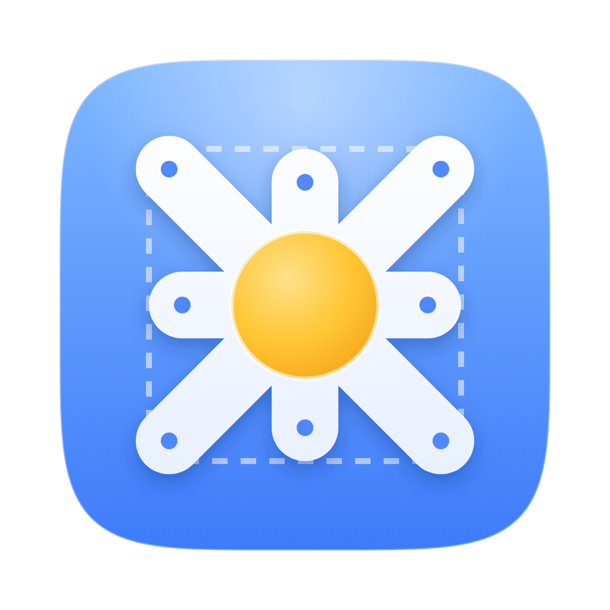
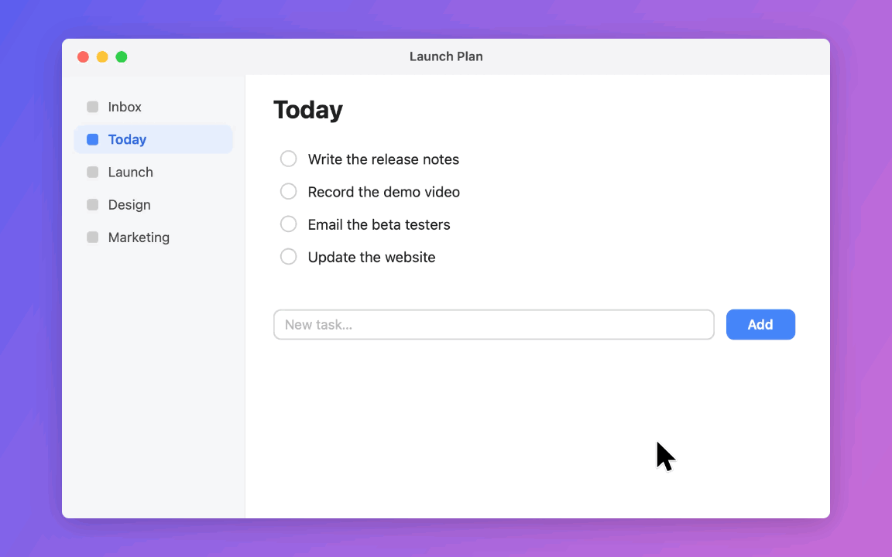
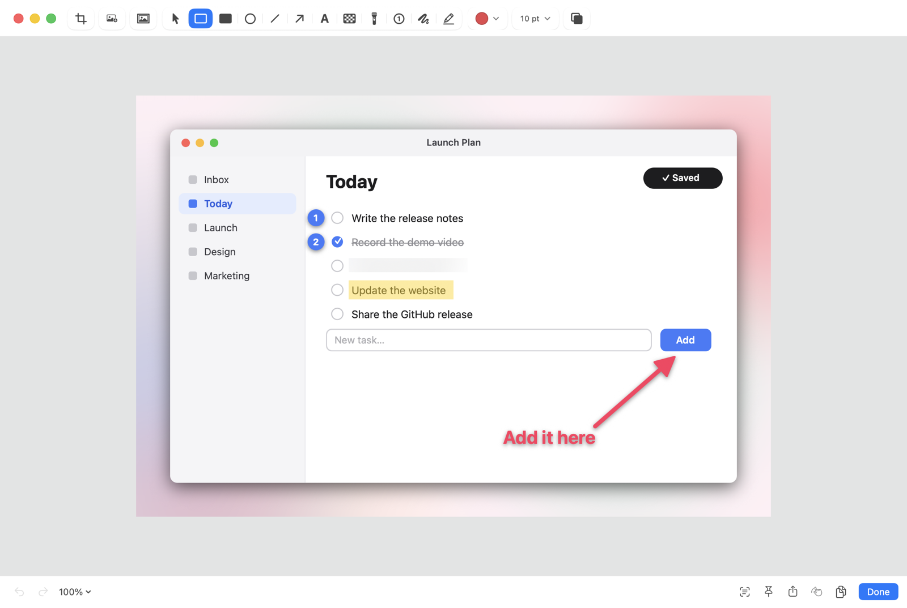
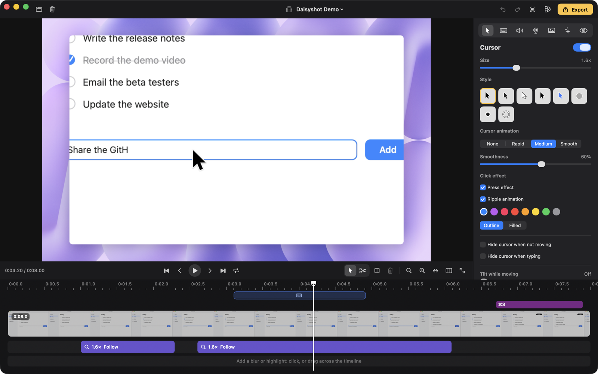
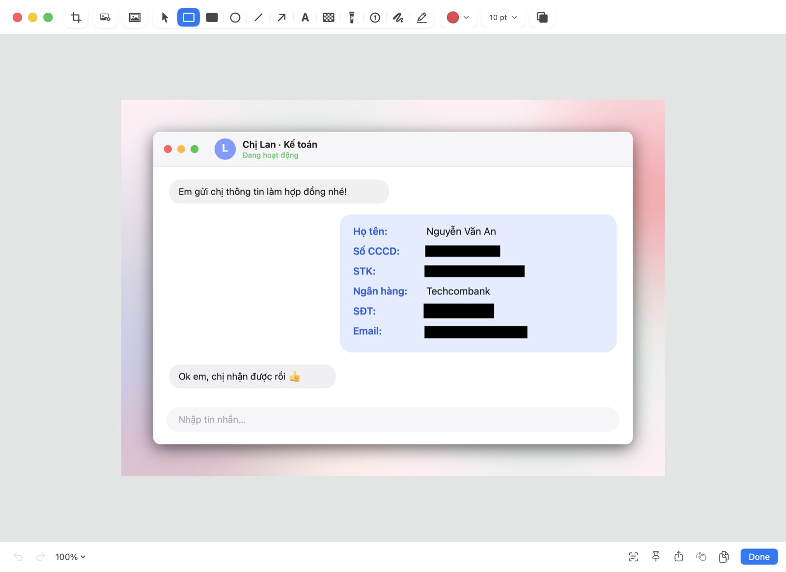

<div align="center">
  
  <br />
  <picture>
    <source media="(prefers-color-scheme: dark)" srcset="Assets/Logo/logotype-white.svg" />
    
  </picture>

  <p><strong>macOS用のスクリーンショット、画面収録、仕上がりのきれいな画面動画を、メニューバーからオフラインで。</strong></p>

  <p><a href="https://daisyshot.app"><strong>daisyshot.app</strong></a></p>

  <p>
    <a href="https://developer.apple.com/xcode/swiftui/">SwiftUI</a>、
    <a href="https://developer.apple.com/documentation/appkit">AppKit</a>、
    <a href="https://developer.apple.com/documentation/screencapturekit">ScreenCaptureKit</a>、
    <a href="https://developer.apple.com/documentation/avfoundation">AVFoundation</a>、
    <a href="https://developer.apple.com/documentation/vision">Vision</a>で構築。サードパーティの依存関係はありません。
  </p>

  <p>
    <a href="README.md">🇺🇸 English</a> •
    <a href="README.vi.md">🇻🇳 Tiếng Việt</a> •
    <a href="README.ko.md">🇰🇷 한국어</a> •
    <a href="README.ja.md">🇯🇵 日本語</a> •
    <a href="README.zh-Hans.md">🇨🇳 简体中文</a>
  </p>

  <p>
    <a href="https://github.com/tamhd148/daisyshot/releases/latest"></a>
    <a href="https://github.com/tamhd148/daisyshot/releases"></a>
    <a href="https://github.com/tamhd148/daisyshot/actions/workflows/build.yml"></a>
    
    <a href="LICENSE"></a>
    <a href="https://ko-fi.com/tamhd"></a>
  </p>

  <p>
    <a href="#インストール">インストール</a> •
    <a href="#クイックスタート">クイックスタート</a> •
    <a href="#機能">機能</a> •
    <a href="#自動墨消し">自動墨消し</a> •
    <a href="#ショートカット">ショートカット</a> •
    <a href="#urlスキームによる自動化">自動化</a> •
    <a href="#セキュリティとプライバシー">セキュリティとプライバシー</a> •
    <a href="#アンインストール">アンインストール</a> •
    <a href="#ソースからビルド">ソースからビルド</a> •
    <a href="#コントリビュート">コントリビュート</a> •
    <a href="#ライセンスと名称">ライセンス</a>
  </p>
</div>



<p align="center"><sub>Studioエディタからそのまま書き出したものです。背景、ズーム、カーソル、キー入力は収録後に追加しています。</sub></p>

Daisyshotは[MITライセンス](LICENSE)のもとで公開されている、無料のオープンソースソフトウェアです。時間の節約に役立ったら、
[Ko-fi](https://ko-fi.com/tamhd)で開発を支援していただけます。

## インストール

1. [最新リリース](https://github.com/tamhd148/daisyshot/releases/latest)から`Daisyshot-<version>.dmg`をダウンロードし、
   Daisyshotを「アプリケーション」フォルダにドラッグします。
2. ビルドはまだAppleの公証を受けていないため、初回起動時にmacOSによってブロックされます。「**完了**」をクリックしてから
   「**システム設定**」›「**プライバシーとセキュリティ**」を開き、Daisyshotの横にある「**このまま開く**」をクリックして確定します。
   （または「ターミナル」で：`xattr -dr com.apple.quarantine /Applications/Daisyshot.app`）
3. 確認が表示されたら「画面収録とシステムオーディオ録音」を許可し、Daisyshotを開き直します。Daisyshotはメニューバーに常駐します。

以降のバージョンはアプリ内からインストールできます（メニューバーのメニューの「**アップデートを確認…**」から、または1日1回自動で）。
アップデートには署名があり、Daisyshotは自身のリリース署名が付いたアーカイブだけをインストールします。

macOS 15 Sequoia以降が必要です。AppleシリコンとIntelのどちらにも対応しています。

## クイックスタート

1. **⌥⇧⌘4**を押して画面の一部をドラッグします（オールインワンバーを使うときは、**⌥⇧⌘5**を押します）。
2. 撮ったスクリーンショットがクイックアクセスのカードに表示されます。ポインタを重ねて、**⌘C**でコピー、**⌘S**で保存、**⌘E**で注釈、
   **⌘P**で画面にピン留めできます。そのままほかのアプリにドラッグすることもできます。
3. **⌥⇧⌘6**を押して収録します。ディスプレイ、ウインドウ、範囲、または接続したiPhone／iPadを選び、「**収録を開始**」をクリックします。
   メニューバーから停止すると、収録がStudioエディタで開き、すぐに書き出せます。

## 機能

**スクリーンショット**
- 範囲、ウインドウ、全画面、前回の範囲、セルフタイマー、スクロールキャプチャ
- 注釈：矢印、図形、テキスト、ペンと蛍光ペン、ぼかしとピクセル化、スポットライト、番号付きステップ、切り取り、
  背景と余白
- [自動墨消し](#自動墨消し)：画像内のAPIキー、パスワード、メールアドレス、電話番号、カード番号とID番号、銀行口座、
  顔を見つけて、その部分だけを覆います
- 画面上のあらゆるものからテキスト（OCR）とQRコードをコピー
- スクリーンショットをほかのウインドウの手前にピン留め、クイックアクセスオーバーレイ、検索できるキャプチャ履歴



**収録**
- ディスプレイ、ウインドウ、範囲、または接続したiPhone／iPad（USB）を収録
- カメラのバブル、マイクとシステムオーディオ（アプリごと）、キー入力とクリックの強調表示、スピーカーノート／プロンプター
- GIF書き出し、MP4書き出し、中断された収録のクラッシュからの復元

**Studioエディタ**（「Studio」の収録用）
- なめらかなカーソル（スタイル、サイズ、モーションブラー、クリック効果とクリック音）、カーソルを追う自動ズーム
- ワンクリックで早送りできるタイピング検出、クリップのカット、トリム、分割、速度アップ
- 背景（macOSの壁紙、グラデーション、画像）、余白、角丸、影、任意の縦横比
- カメラレイアウト（カメラのみ、画面のみ、カスタム位置）、機密テキストを見つけるぼかし・ハイライトのマスク
- BGM、ノイズ低減、ラウドネスノーマライズ
- 縦型・正方形の動画向けの「フレームを埋めてカーソルを追う」、1回の書き出しで複数のフォーマット
- プリセット、収録直後のクイック書き出し、あらゆる操作に対応するキーボードショートカット



インターフェイスの言語：English、Tiếng Việt、한국어、日本語、简体中文。

## 自動墨消し

Daisyshotはスクリーンショット内のテキスト（Studioエディタのマスクでは収録内のテキストも）を読み取り、共有すべきでない部分を覆います。
覆うのは値だけなので、隣にあるラベルは読めるままです。処理はすべてAppleのVisionを使ってMac上で行われます。



<p align="center"><sub>手作業ではなく、自動墨消しが見つけて覆ったものです。画像内の情報はすべて架空のものです。</sub></p>

| 検出対象 | 検出方法 |
|---|---|
| APIキーとシークレット | 既知のキー形式（クラウドプロバイダ、AIサービス、GitHub、Slack、JWT、秘密鍵など）と、`key`、`token`、`secret`などの後に続く長いランダムな値 |
| パスワード | `password`、`pwd`、`mật khẩu`などの後に続く値 |
| メールアドレス、URL内のトークン、IPアドレス | メールアドレス、リンク内の`token=`、`key=`、`session=`などの値、IPv4とIPv6（デフォルトはオフ） |
| 電話番号 | ベトナムの携帯電話番号（`+84`／`0`に続けて3、5、7、8、9）と国際電話番号 |
| カード番号 | Luhnチェックに通り、実在するカードと同じように始まる13〜19桁の数字 |
| **ID番号（CCCD／CMND）** | `CCCD`、`CMND`、`căn cước`、`chứng minh`の隣にある12桁または9桁の数字 |
| **銀行口座** | `STK`、`số tài khoản`、`số TK`、`account no.`の隣にある数字、IBAN |
| 顔 | Apple Visionの顔検出（デフォルトはオフ） |
| 独自のパターン | キーワードまたは正規表現 — プロジェクトのコードネーム、顧客IDなど |

注釈ツール（`⇧⌘R`）で実行するほか、キャプチャのたびに自動で実行したり、Studioエディタの「**機密情報を検出**」で実行したりできます。Studioエディタでは収録にぼかしのマスクが追加され、マスクの下の内容が動くと警告が表示されます。
また、シークレット、パスワード、カード番号が写ったままのスクリーンショットをコピー、ドラッグ、共有しようとしたときに警告することもできます。
検出する項目、墨消しのスタイル、独自のパターンは「**設定**」›「**スクリーンショット**」で選択できます。

## ショートカット

標準で使えるグローバルショートカットは次のとおりです（「**設定**」›「**ショートカット**」で変更・追加できます。一時停止／再開、最初から、
マーカー、スピーカーノートなども、デフォルトのショートカットなしでそこに用意されています）：

| 操作 | ショートカット |
|---|---|
| オールインワンのキャプチャバー | `⌥⇧⌘5` |
| 範囲をキャプチャ | `⌥⇧⌘4` |
| 全画面をキャプチャ | `⌥⇧⌘3` |
| ウインドウをキャプチャ | `⌥⇧⌘W` |
| 前回の範囲をキャプチャ | `⌥⇧⌘7` |
| スクロールキャプチャ | `⌥⇧⌘8` |
| テキストをキャプチャ（OCR） | `⌥⇧⌘2` |
| 画面を収録／収録を停止 | `⌥⇧⌘6` |
| デスクトップアイコンを非表示／表示 | `⌥⇧⌘D` |
| 最近閉じた項目を復元 | `⌥⇧⌘Z` |

**クイックアクセスのカード** — カードにポインタを重ねてから、次のキーを押します：

| 操作 | キー |
|---|---|
| コピー | `⌘C` |
| 保存（`⌥`を押したままにすると、もう一方の保存方法） | `⌘S` |
| 注釈／編集 | `⌘E` |
| 画面にピン留め | `⌘P` |
| クイックルック | `Space` |
| ゴミ箱に入れる | `⌘⌫` |
| 閉じる | `⌘W`または`Esc` |

Studioエディタには独自のショートカットがあります（すべて割り当てを変更できます）。エディタで`⌘/`を押すと一覧が表示されます。

## URLスキームによる自動化

ランチャー、スクリプト、ショートカットAppから、`daisyshot://` URLを使ってDaisyshotを操作できます。例：
`open "daisyshot://capture-area?action=copy"`。ほかのアプリから初めてコマンドが送られたときは、実行前にDaisyshotが確認します。
APIは「**設定**」›「**詳細**」でオフにできます。

| コマンド | 内容 |
|---|---|
| `capture-area` | 範囲をキャプチャ（ポイント単位の`x`、`y`、`width`、`height`と`display`を指定すると、選択せずにキャプチャ） |
| `capture-previous-area` | 前回の範囲をもう一度キャプチャ |
| `capture-fullscreen` | ディスプレイ全体をキャプチャ（`display`：1、2…） |
| `capture-window` | ウインドウをキャプチャ |
| `all-in-one` | オールインワンバーを開く |
| `self-timer` | カウントダウン後にキャプチャ |
| `scrolling-capture` | スクロールキャプチャ（`start`、`autoscroll`：true／false） |
| `capture-text` | 画面または`filepath`からテキストをコピー（OCR）。`linebreaks`：true／false |
| `record-screen` | 収録を開始、または実行中の収録を停止 |
| `stop-recording` | 実行中の収録を停止 |
| `pin` | `filepath`（または選択した画像）を画面にピン留め |
| `open-annotate` | `filepath`（または選択したファイル）に注釈を付ける |
| `open-from-clipboard` | クリップボードの画像に注釈を付ける |
| `add-quick-access-overlay` | `filepath`をクイックアクセスのカードに表示 |
| `open-history` | キャプチャ履歴を開く |
| `restore-recently-closed` | 最後に閉じたクイックアクセスのカードを元に戻す |
| `close-all-overlays` | すべてのクイックアクセスのカードを閉じる |
| `toggle-desktop-icons`、`hide-desktop-icons`、`show-desktop-icons` | デスクトップアイコン |
| `open-settings` | 設定を開く（`tab`：general, shortcuts, quickAccess, wallpaper, screenshots, screenRecording, annotate, advanced, about） |

キャプチャ系のコマンドでは、`action` = `copy`、`save`、`annotate`、`pin`を指定して「キャプチャ後」の設定を上書きすることもできます。

## セキュリティとプライバシー

Daisyshotはオフラインで動作します。アカウント、分析、クラウドはありません。スクリーンショットと収録はMacの中にとどまり、
選択したフォルダと`~/Library/Application Support/Daisyshot`に保存されます。

- **ネットワーク：** 通信はアップデートの確認だけです。1日1回、GitHubに最新リリースを問い合わせます（「**設定**」›「**一般**」で
  オフにできます）。ユーザやファイルに関する情報は一切送信されません。アップデートはインストールするときにだけダウンロードされ、
  DaisyshotのEd25519リリース署名があり、想定どおりのアプリとバージョンである場合にのみインストールされます。
- **コード：** アプリはmacOSのHardened Runtimeで動作し、サンドボックス化されていません（画面キャプチャ、グローバルショートカット、
  キー入力の記録にはそれが必要なため）。リリースはアドホック署名で、まだAppleの公証を受けていません。
- **自動化：** ほかのアプリからの`daisyshot://`コマンドには初回にユーザの許可が必要で、オフにすることもできます。

Daisyshotは次のmacOSのアクセス権を求めます。それぞれ、必要とする機能でのみ使用されます：

| アクセス権 | 用途 |
|---|---|
| 画面収録とシステムオーディオ録音 | スクリーンショットの撮影と画面収録 |
| アクセシビリティ | 収録内のキー入力、タイピング検出、入力中のポインタの非表示、ウインドウを最前面に移動 |
| カメラ／マイク | 収録時のカメラのバブルと音声 |

セキュリティ上の問題を見つけた場合は、非公開で報告してください。詳しくは[SECURITY.md](SECURITY.md)をご覧ください。

## アンインストール

Daisyshotを終了してから、次を実行します：

```bash
rm -rf /Applications/Daisyshot.app
```

設定とアクセス権も削除するには：

```bash
defaults delete app.daisyshot.mac; tccutil reset All app.daisyshot.mac
```

`~/Library/Application Support/Daisyshot`にはキャプチャ履歴、収録、プリセットが保存されています。不要になった場合にのみ削除してください。
アンインストールせずにアクセス権だけをリセットするには、`tccutil reset All app.daisyshot.mac`のみを実行します。

## ソースからビルド

必要なもの：Xcode 26（Swift 6、macOS 26 SDK）。サードパーティの依存関係はありません。

```bash
swift build                      # debug build
./scripts/build-app.sh           # signed app bundle in build/Daisyshot.app (ad-hoc unless SIGN_ID is set)
./scripts/make-dmg.sh            # disk image for distribution
```

リリース：最初に一度だけ`swift scripts/update-key.swift generate`を実行します（リポジトリの外に署名鍵を作成し、
`Updater.publicKey`に設定する公開鍵を表示します）。その後、`VERSION`を上げ、リリースノートを書いて
`./scripts/release.sh notes.md`を実行します。ディスクイメージと署名付きのアップデートアーカイブがビルドされ、GitHubのリリースが公開されます。

組み込みのチェックは`DAISYSHOT_SELFTEST=1 .build/debug/Daisyshot`で実行できます（領域ごとにPASS／FAILを表示して終了します）。
翻訳は`python3 scripts/loc-check.py`でチェックします。

コードの構成（`Sources/Daisyshot`）：

| フォルダ | 内容 |
|---|---|
| `App` | アプリデリゲート、グローバルショートカット、環境設定、URLスキームAPI、アクセス権、アップデート |
| `Capture` | スクリーンショットのキャプチャ、選択オーバーレイ、スクロールキャプチャ、OCR |
| `Annotate` | 注釈エディタ、背景、自動墨消し |
| `Recording` | レコーダー、収録の設定、Studioエディタ（モデル、レンダラ、タイムライン、書き出し） |
| `UI` | クイックアクセス、ピン、履歴、共通UI |
| `Settings` | 設定ウインドウとパネル |

## コントリビュート

バグ報告、修正、翻訳を歓迎します。[CONTRIBUTING.md](CONTRIBUTING.md)をご覧ください。

## ライセンスと名称

ソースコードは[MITライセンス](LICENSE)のもとで提供されています。© 2026 Tam Hoang

**Daisyshot**という名称、Daisyshotのロゴおよびアプリアイコンは、MITライセンスの対象外です。コードをフォークして再配布するのは
自由ですが、公式アプリと間違われないよう、あなたのバージョンには別の名前とアイコンを付けてください。
