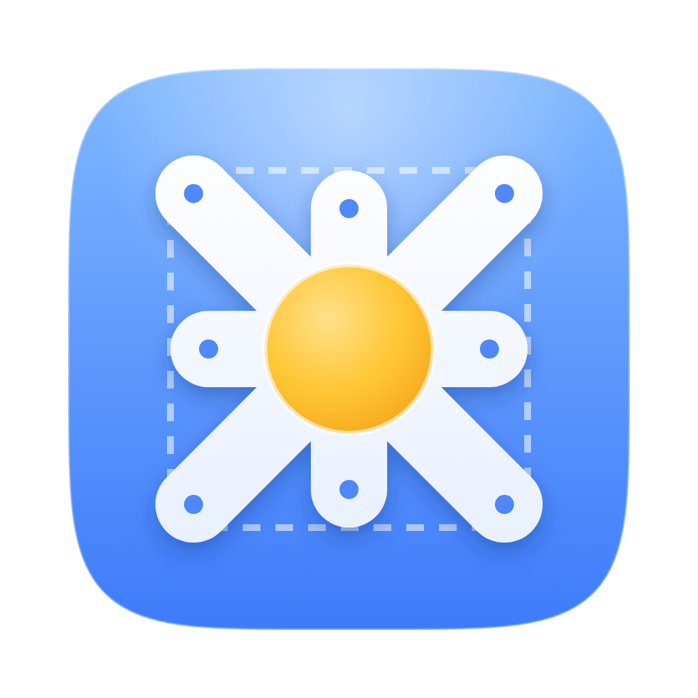
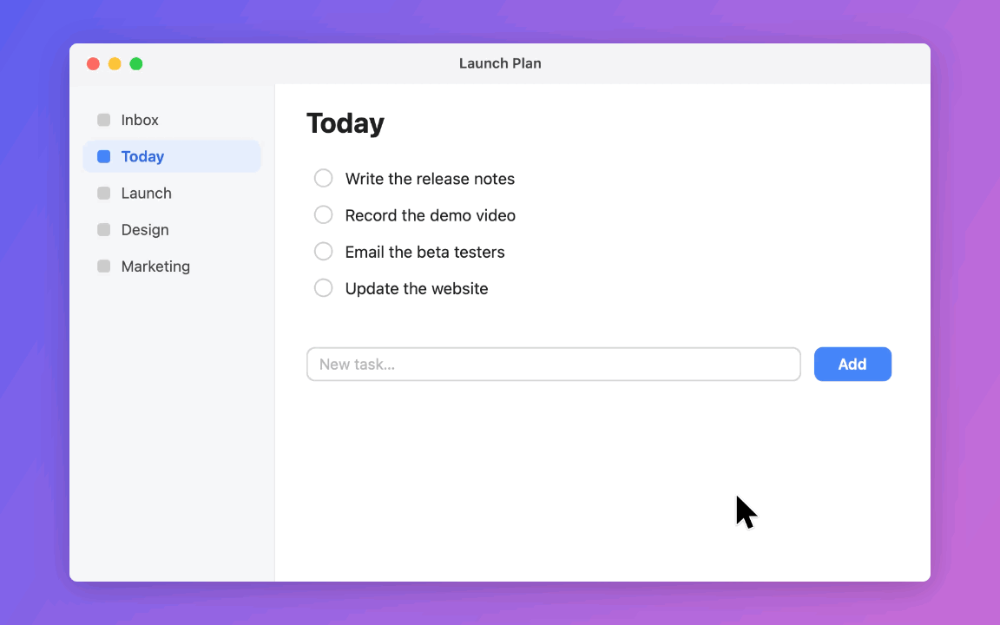
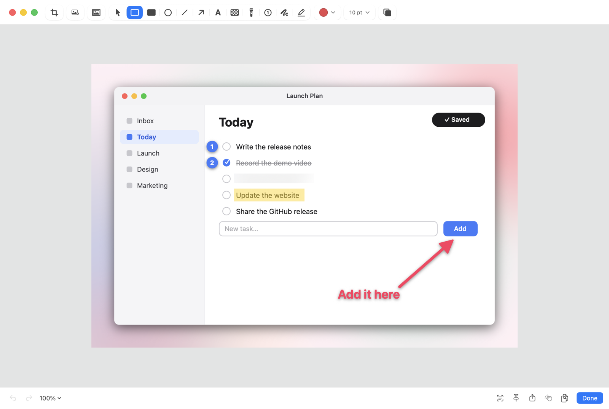
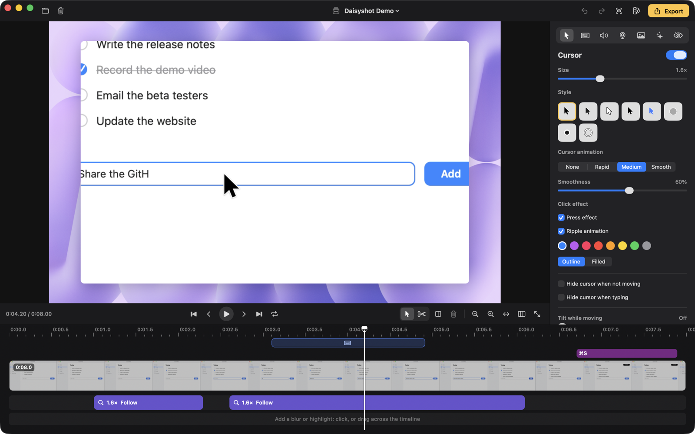
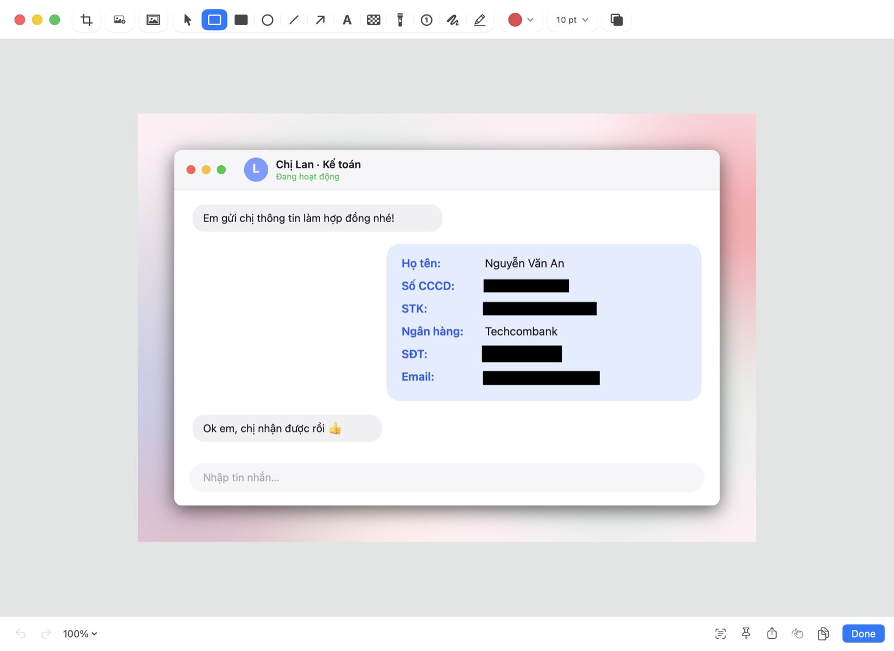

<div align="center">
  
  <br />
  <picture>
    <source media="(prefers-color-scheme: dark)" srcset="Assets/Logo/logotype-white.svg" />
    
  </picture>

  <p><strong>macOS용 스크린샷, 화면 녹화, 완성도 높은 화면 영상 — 메뉴 막대에서, 오프라인으로.</strong></p>

  <p><a href="https://daisyshot.app"><strong>daisyshot.app</strong></a></p>

  <p>
    <a href="https://developer.apple.com/xcode/swiftui/">SwiftUI</a>,
    <a href="https://developer.apple.com/documentation/appkit">AppKit</a>,
    <a href="https://developer.apple.com/documentation/screencapturekit">ScreenCaptureKit</a>,
    <a href="https://developer.apple.com/documentation/avfoundation">AVFoundation</a>,
    <a href="https://developer.apple.com/documentation/vision">Vision</a>으로 만들었으며 서드파티 의존성이 없습니다.
  </p>

  <p>
    <a href="README.md">🇺🇸 English</a> •
    <a href="README.vi.md">🇻🇳 Tiếng Việt</a> •
    <a href="README.ko.md">🇰🇷 한국어</a> •
    <a href="README.ja.md">🇯🇵 日本語</a> •
    <a href="README.zh-Hans.md">🇨🇳 简体中文</a>
  </p>

  <p>
    <a href="https://github.com/tamhd148/daisyshot/releases/latest"></a>
    <a href="https://github.com/tamhd148/daisyshot/releases"></a>
    <a href="https://github.com/tamhd148/daisyshot/actions/workflows/build.yml"></a>
    
    <a href="LICENSE"></a>
    <a href="https://ko-fi.com/tamhd"></a>
  </p>

  <p>
    <a href="#설치">설치</a> •
    <a href="#빠른-시작">빠른 시작</a> •
    <a href="#기능">기능</a> •
    <a href="#자동-가림">자동 가림</a> •
    <a href="#단축키">단축키</a> •
    <a href="#자동화-url-스킴">자동화</a> •
    <a href="#보안-및-개인정보-보호">보안 및 개인정보 보호</a> •
    <a href="#제거">제거</a> •
    <a href="#소스에서-빌드">소스에서 빌드</a> •
    <a href="#기여하기">기여하기</a> •
    <a href="#라이선스-및-이름">라이선스</a>
  </p>
</div>



<p align="center"><sub>Studio 편집기에서 바로 내보낸 영상입니다. 배경, 줌, 커서, 키 입력은 모두 녹화 후에 추가했습니다.</sub></p>

Daisyshot은 [MIT 라이선스](LICENSE)에 따라 무료로 제공되는 오픈 소스입니다. 시간을 아끼는 데 도움이 되었다면
[Ko-fi](https://ko-fi.com/tamhd)에서 개발을 후원할 수 있습니다.

## 설치

1. [최신 릴리스](https://github.com/tamhd148/daisyshot/releases/latest)에서 `Daisyshot-<version>.dmg`를 다운로드하고
   Daisyshot을 응용 프로그램 폴더로 드래그합니다.
2. 아직 Apple의 공증을 받지 않은 빌드이므로 처음 실행할 때 macOS가 차단합니다. **완료**를 클릭한 다음
   **시스템 설정 › 개인정보 보호 및 보안**을 열고 Daisyshot 옆의 **그래도 열기**를 클릭하여 확인합니다.
   (또는 터미널에서 `xattr -dr com.apple.quarantine /Applications/Daisyshot.app`을 실행합니다.)
3. 요청이 표시되면 화면 및 시스템 오디오 녹음을 허용한 다음 Daisyshot을 다시 엽니다. Daisyshot은 메뉴 막대에 있습니다.

이후 버전은 앱 안에서 설치됩니다(메뉴 막대 메뉴의 **업데이트 확인…** 또는 하루 한 번 자동으로).
업데이트는 서명되어 있으며, Daisyshot은 자체 릴리스 서명이 있는 아카이브만 설치합니다.

macOS 15 Sequoia 이상, Apple 실리콘 또는 Intel이 필요합니다.

## 빠른 시작

1. **⌥⇧⌘4**를 누르고 화면의 일부를 드래그합니다(올인원 바를 열려면 **⌥⇧⌘5**).
2. 캡처한 이미지가 빠른 접근 카드에 나타납니다. 카드 위에 포인터를 올리고 **⌘C**를 눌러 복사, **⌘S**를 눌러 저장,
   **⌘E**를 눌러 주석 달기, **⌘P**를 눌러 화면에 고정하거나, 다른 앱으로 바로 드래그합니다.
3. **⌥⇧⌘6**을 눌러 녹화합니다. 디스플레이, 윈도우, 영역 또는 연결된 iPhone / iPad를 선택한 다음 **녹화 시작**을 누릅니다.
   메뉴 막대에서 녹화를 중단하면 녹화가 Studio 편집기에서 열리고 바로 내보낼 수 있습니다.

## 기능

**스크린샷**
- 영역, 윈도우, 전체 화면, 이전 영역, 타이머 캡처, 스크롤 캡처
- 주석: 화살표, 도형, 텍스트, 펜과 형광펜, 흐림과 픽셀화, 스포트라이트, 번호 단계, 자르기,
  배경과 여백
- [자동 가림](#자동-가림): 이미지에서 API 키, 암호, 이메일, 전화번호, 카드 번호와 신분증 번호, 은행 계좌,
  얼굴을 찾아 해당 부분만 가립니다
- 화면에 보이는 모든 것에서 텍스트 복사(OCR) 및 QR 코드 읽기
- 스크린샷을 다른 윈도우 위에 고정, 빠른 접근 오버레이, 검색 가능한 캡처 기록



**녹화**
- 디스플레이, 윈도우, 영역 또는 연결된 iPhone / iPad(USB) 녹화
- 카메라 버블, 마이크와 시스템 오디오(앱별), 키 입력과 클릭 강조 표시, 발표자 노트 / 텔레프롬프터
- GIF 내보내기, MP4 내보내기, 중단된 녹화의 충돌 복구

**Studio 편집기** ("Studio" 녹화용)
- 부드러운 커서(스타일, 크기, 모션 블러, 클릭 효과와 사운드), 커서를 따라가는 자동 줌
- 원클릭으로 빠르게 할 수 있는 타이핑 감지, 클립 자르기, 트리밍, 분할, 속도 높이기
- 배경(macOS 배경화면, 그라디언트, 이미지), 여백, 둥근 모서리, 그림자, 모든 화면비
- 카메라 레이아웃(카메라만, 화면만, 사용자 지정 위치), 민감한 텍스트를 찾아 주는 흐림 및 강조 마스크
- 배경 음악, 소음 줄이기, 음량 평준화
- 세로 또는 정사각형 영상을 위한 "프레임을 채우고 커서 따라가기", 한 번의 내보내기로 여러 포맷 생성
- 프리셋, 녹화 직후 빠른 내보내기, 모든 기능에 대한 키보드 단축키



인터페이스 언어: English, Tiếng Việt, 한국어, 日本語, 简体中文.

## 자동 가림

Daisyshot은 스크린샷(그리고 Studio 편집기의 마스크를 위해 녹화 영상)의 텍스트를 읽고 공유해서는 안 되는 내용을 가립니다.
값만 가리므로 옆에 있는 레이블은 그대로 읽을 수 있습니다. 모든 처리는 Apple의 Vision을 사용해 Mac에서 이루어집니다.



<p align="center"><sub>손으로 가린 것이 아니라 자동 가림이 찾아서 가렸습니다. 그림 속 모든 정보는 가상으로 만든 것입니다.</sub></p>

| 찾는 항목 | 방법 |
|---|---|
| API 키와 비밀 정보 | 알려진 키 형식(클라우드 제공업체, AI 서비스, GitHub, Slack, JWT, 개인 키…) 및 `key`, `token`, `secret`… 뒤에 오는 긴 무작위 값 |
| 암호 | `password`, `pwd`, `mật khẩu`… 뒤에 오는 값 |
| 이메일, URL 속 토큰, IP 주소 | 이메일 주소, 링크 속 `token=`, `key=`, `session=`… 값, IPv4 및 IPv6(기본적으로 꺼짐) |
| 전화번호 | 베트남 휴대전화 번호(`+84` / `0`과 3, 5, 7, 8, 9) 및 국제 전화번호 |
| 카드 번호 | Luhn 검사를 통과하고 실제 카드처럼 시작하는 13–19자리 숫자 |
| **신분증 번호(CCCD / CMND)** | `CCCD`, `CMND`, `căn cước`, `chứng minh` 옆에 있는 12자리 또는 9자리 숫자 |
| **은행 계좌** | `STK`, `số tài khoản`, `số TK`, `account no.` 옆에 있는 숫자, IBAN |
| 얼굴 | Apple Vision 얼굴 감지(기본적으로 꺼짐) |
| 사용자 지정 패턴 | 키워드 또는 정규 표현식 — 프로젝트 코드명, 고객 ID… |

주석 편집기(`⇧⌘R`)에서 실행하거나, 캡처할 때마다 자동으로 실행하거나, Studio 편집기에서 **민감한 정보 찾기**로 실행할 수 있습니다. 민감한 정보 찾기는 녹화 영상에 흐림 마스크를 추가하고 마스크 아래의 내용이 움직이면 경고합니다. Daisyshot은
비밀 정보, 암호 또는 카드 번호가 아직 보이는 스크린샷을 복사, 드래그 또는 공유하기 전에 경고할 수도 있습니다. 찾을 항목, 가리는
스타일, 사용자 지정 패턴은 **설정 › 스크린샷**에서 선택합니다.

## 단축키

기본 제공 전역 단축키입니다(**설정 › 단축키**에서 변경하거나 추가할 수 있으며, 일시 정지 / 재개, 다시 시작, 마커,
발표자 노트 등은 기본 단축키 없이 그곳에서 지정할 수 있습니다).

| 동작 | 단축키 |
|---|---|
| 올인원 캡처 바 | `⌥⇧⌘5` |
| 영역 캡처 | `⌥⇧⌘4` |
| 전체 화면 캡처 | `⌥⇧⌘3` |
| 윈도우 캡처 | `⌥⇧⌘W` |
| 이전 영역 캡처 | `⌥⇧⌘7` |
| 스크롤 캡처 | `⌥⇧⌘8` |
| 텍스트 캡처 (OCR) | `⌥⇧⌘2` |
| 화면 기록 / 녹화 중단 | `⌥⇧⌘6` |
| 데스크탑 아이콘 가리기 / 보기 | `⌥⇧⌘D` |
| 최근 닫은 항목 복원 | `⌥⇧⌘Z` |

**빠른 접근 카드** — 카드 위에 포인터를 올린 다음 누릅니다.

| 동작 | 키 |
|---|---|
| 복사 | `⌘C` |
| 저장(다른 저장 방식을 사용하려면 `⌥`를 누른 채로) | `⌘S` |
| 주석 달기 / 편집 | `⌘E` |
| 화면에 고정 | `⌘P` |
| 훑어보기 | `Space` |
| 휴지통으로 이동 | `⌘⌫` |
| 닫기 | `⌘W` 또는 `Esc` |

Studio 편집기에는 자체 단축키가 있으며(모두 변경 가능), 편집기에서 `⌘/`를 누르면 확인할 수 있습니다.

## 자동화 URL 스킴

런처, 스크립트, 단축어 앱에서 `daisyshot://` URL로 Daisyshot을 제어할 수 있습니다. 예:
`open "daisyshot://capture-area?action=copy"`. 다른 앱이 처음 명령을 보내면 Daisyshot은 실행하기 전에
확인을 요청합니다. API는 **설정 › 고급**에서 끌 수 있습니다.

| 명령 | 동작 |
|---|---|
| `capture-area` | 영역 캡처(`x`, `y`, `width`, `height`(포인트 단위)와 `display`를 지정하면 선택 없이 캡처) |
| `capture-previous-area` | 마지막 영역을 다시 캡처 |
| `capture-fullscreen` | 디스플레이 전체 캡처(`display`: 1, 2…) |
| `capture-window` | 윈도우 캡처 |
| `all-in-one` | 올인원 바 열기 |
| `self-timer` | 카운트다운 후 캡처 |
| `scrolling-capture` | 스크롤 캡처(`start`, `autoscroll`: true / false) |
| `capture-text` | 화면 또는 `filepath`에서 텍스트 복사(OCR), `linebreaks`: true / false |
| `record-screen` | 녹화를 시작하거나 진행 중인 녹화를 중단 |
| `stop-recording` | 진행 중인 녹화를 중단 |
| `pin` | `filepath`(또는 선택한 이미지)를 화면에 고정 |
| `open-annotate` | `filepath`(또는 선택한 파일)에 주석 달기 |
| `open-from-clipboard` | 클립보드의 이미지에 주석 달기 |
| `add-quick-access-overlay` | `filepath`를 빠른 접근 카드에 표시 |
| `open-history` | 캡처 기록 열기 |
| `restore-recently-closed` | 마지막으로 닫은 빠른 접근 카드 복원 |
| `close-all-overlays` | 모든 빠른 접근 카드 닫기 |
| `toggle-desktop-icons`, `hide-desktop-icons`, `show-desktop-icons` | 데스크탑 아이콘 |
| `open-settings` | 설정 열기(`tab`: general, shortcuts, quickAccess, wallpaper, screenshots, screenRecording, annotate, advanced, about) |

캡처 명령은 `action` = `copy`, `save`, `annotate` 또는 `pin`도 받으며, 이를 지정하면 캡처 후 설정 대신 해당 동작을 수행합니다.

## 보안 및 개인정보 보호

Daisyshot은 오프라인으로 작동합니다. 계정도, 분석도, 클라우드도 없습니다. 스크린샷과 녹화 파일은 사용자가 선택한 폴더와
`~/Library/Application Support/Daisyshot`에 저장되며 Mac 밖으로 나가지 않습니다.

- **네트워크:** 유일한 요청은 업데이트 확인입니다. 하루에 한 번 GitHub에 최신 릴리스를 묻습니다(**설정 › 일반**에서
  끌 수 있음). 사용자나 사용자의 파일에 관한 정보는 전송되지 않습니다. 업데이트는 설치할 때만 다운로드되며,
  Daisyshot의 Ed25519 릴리스 서명이 있고 예상한 앱과 버전일 때만 설치됩니다.
- **코드:** 앱은 macOS Hardened Runtime으로 실행되며 샌드박스가 적용되지 않습니다(화면 캡처, 전역 단축키,
  키 입력 기록에 필요). 릴리스는 ad-hoc 서명되어 있으며 아직 Apple의 공증을 받지 않았습니다.
- **자동화:** 다른 앱에서 보낸 `daisyshot://` 명령은 처음에 사용자의 승인이 필요하며, 끌 수 있습니다.

Daisyshot은 다음 macOS 권한을 요청하며, 각 권한은 해당 권한이 필요한 기능에만 사용됩니다.

| 권한 | 용도 |
|---|---|
| 화면 및 시스템 오디오 녹음 | 스크린샷 촬영 및 화면 녹화 |
| 손쉬운 사용 | 녹화 속 키 입력, 타이핑 감지, 입력하는 동안 커서 가리기, 윈도우를 앞으로 가져오기 |
| 카메라 / 마이크 | 카메라 버블 및 녹화 속 음성 |

보안 문제를 발견했습니까? 비공개로 알려 주십시오. [SECURITY.md](SECURITY.md)를 참고하십시오.

## 제거

Daisyshot을 종료한 다음 실행합니다.

```bash
rm -rf /Applications/Daisyshot.app
```

설정과 권한도 함께 제거하려면:

```bash
defaults delete app.daisyshot.mac; tccutil reset All app.daisyshot.mac
```

`~/Library/Application Support/Daisyshot`에는 캡처 기록, 녹화 파일, 프리셋이 들어 있습니다. 더 이상 필요하지 않을 때만
삭제하십시오. 제거하지 않고 권한만 재설정하려면 `tccutil reset All app.daisyshot.mac`만 실행합니다.

## 소스에서 빌드

요구 사항: Xcode 26(Swift 6, macOS 26 SDK). 서드파티 의존성은 없습니다.

```bash
swift build                      # debug build
./scripts/build-app.sh           # signed app bundle in build/Daisyshot.app (ad-hoc unless SIGN_ID is set)
./scripts/make-dmg.sh            # disk image for distribution
```

릴리스: 처음 한 번 `swift scripts/update-key.swift generate`를 실행합니다(저장소 밖에 서명 키를 만들고
`Updater.publicKey`에 넣을 공개 키를 출력함). 그런 다음 `VERSION`을 올리고 릴리스 노트를 작성한 뒤
`./scripts/release.sh notes.md`를 실행합니다. 이 스크립트가 디스크 이미지와 서명된 업데이트 아카이브를 빌드하고 GitHub 릴리스를 게시합니다.

내장 검사는 `DAISYSHOT_SELFTEST=1 .build/debug/Daisyshot`으로 실행합니다(영역별로 PASS / FAIL을 출력하고 종료함).
번역은 `python3 scripts/loc-check.py`로 검사합니다.

코드 구성(`Sources/Daisyshot`):

| 폴더 | 내용 |
|---|---|
| `App` | 앱 델리게이트, 전역 단축키, 환경설정, URL 스킴 API, 권한, 업데이트 |
| `Capture` | 스크린샷 캡처, 선택 오버레이, 스크롤 캡처, OCR |
| `Annotate` | 주석 편집기, 배경, 자동 가림 |
| `Recording` | 녹화기, 녹화 설정, Studio 편집기(모델, 렌더러, 타임라인, 내보내기) |
| `UI` | 빠른 접근, 고정 이미지, 기록, 공용 UI |
| `Settings` | 설정 윈도우와 패널 |

## 기여하기

버그 신고, 수정, 번역을 환영합니다. [CONTRIBUTING.md](CONTRIBUTING.md)를 참고하십시오.

## 라이선스 및 이름

소스 코드는 [MIT 라이선스](LICENSE)에 따라 사용이 허가됩니다. © 2026 Tam Hoang.

**Daisyshot**이라는 이름과 Daisyshot 로고 및 앱 아이콘은 MIT 라이선스의 적용 대상이 아닙니다. 코드를 포크하고
재배포하는 것은 자유이지만, 사람들이 공식 앱으로 오인하지 않도록 사용자의 버전에는 다른 이름과 아이콘을 사용해 주십시오.
