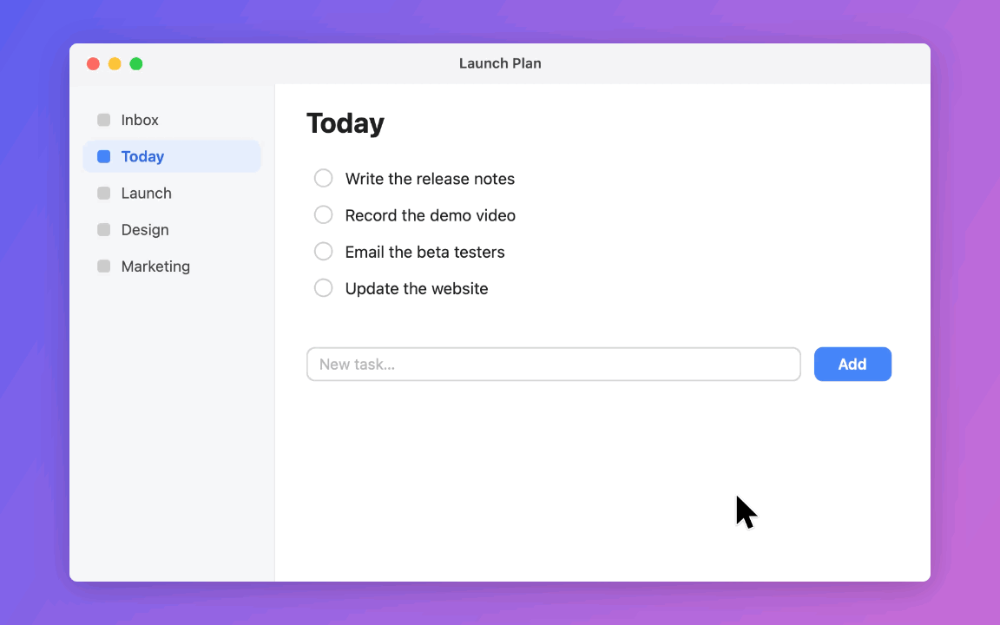
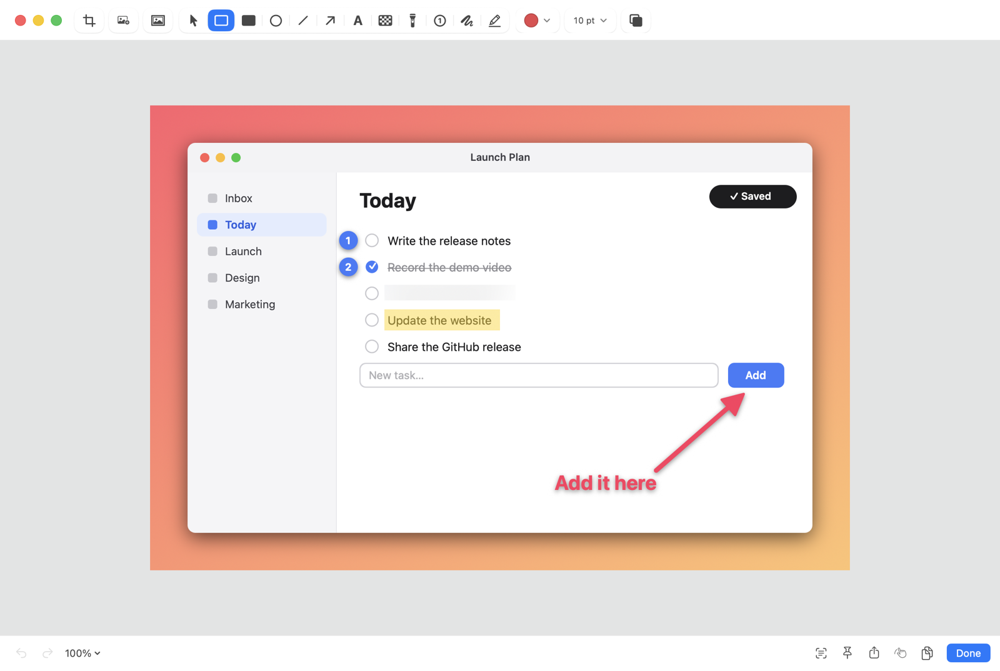
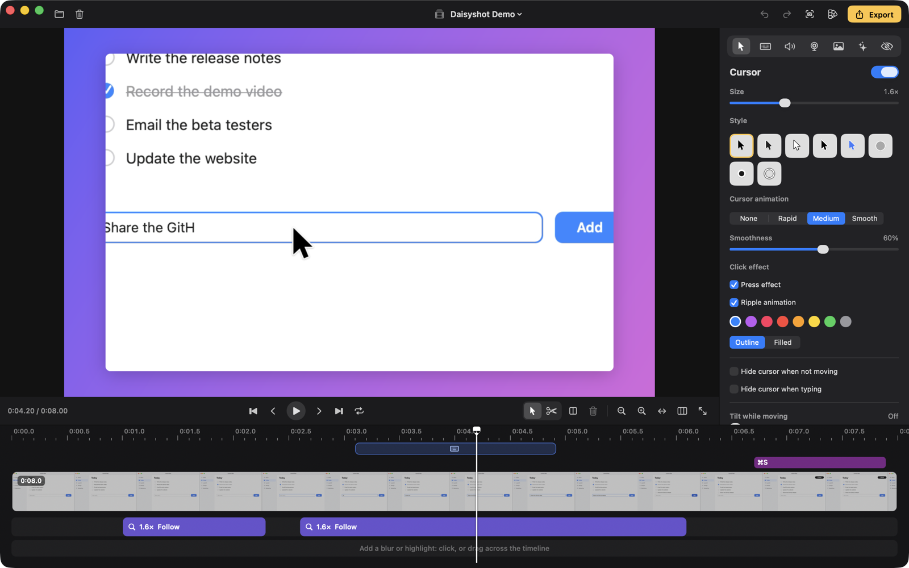

# Daisyshot

Screenshots, screen recordings and polished screen videos for macOS — in one small, native menu bar app that works
offline.



<sub>Exported straight from the Studio editor — background, zooms, cursor and keystrokes are added after recording.</sub>

Daisyshot is free and open source under the [MIT License](LICENSE). If it saves you time, you can support its
development on [Ko-fi](https://ko-fi.com/tamhd).

## Features

**Screenshots**
- Area, window, full screen, previous area, self-timer and scrolling capture
- Annotate: arrows, shapes, text, pen and highlighter, blur and pixelate, spotlight, numbered steps, crop,
  backgrounds and padding
- Auto Redact: finds emails, phone numbers, API keys, passwords and more in the image and blurs just those words
- Copy text (OCR) and QR codes from anything on screen
- Pin screenshots on top of other windows; Quick Access overlay; searchable capture history



**Recording**
- Record a display, a window, an area or a connected iPhone / iPad (USB)
- Camera bubble, microphone and system audio (per app), keystrokes and click highlights, speaker notes / teleprompter
- GIF export, MP4 export, crash recovery for interrupted recordings

**Studio editor** (for "Studio" recordings)
- Smooth cursor (styles, size, motion blur, click effects and sounds), automatic zooms that follow the cursor
- Typing detection with one-click speed-up; cut, trim, split and speed up clips
- Backgrounds (macOS wallpapers, gradients, images), padding, rounded corners, shadows, any aspect ratio
- Camera layouts (camera only, screen only, custom position), blur and highlight masks that find sensitive text
- Background music, noise reduction, loudness normalization
- "Fill the frame and follow the cursor" for vertical or square video, and several formats in one export
- Presets, Quick Export right after recording, keyboard shortcuts for everything



Interface languages: English, Tiếng Việt, 한국어, 日本語, 简体中文.

## Privacy

Daisyshot works offline: no accounts, no analytics, no cloud. Screenshots and recordings stay on your Mac. Its only
network request is the update check — once a day it asks GitHub whether there's a newer release (turn it off in
Settings › General); nothing about you or your files is sent. It asks for these macOS permissions, each only for the
features that need it:

| Permission | Used for |
|---|---|
| Screen & System Audio Recording | Taking screenshots and recording the screen |
| Accessibility | Keystrokes in recordings, typing detection, hiding the cursor while typing, bringing windows to the front |
| Camera / Microphone | The camera bubble and voice in recordings |

## Install

1. Download the latest `Daisyshot.dmg` from Releases and drag Daisyshot into Applications.
2. Builds aren't notarized by Apple yet, so macOS blocks the first launch. Click **Done**, then open
   **System Settings › Privacy & Security**, click **Open Anyway** next to Daisyshot and confirm.
   (Or in Terminal: `xattr -dr com.apple.quarantine /Applications/Daisyshot.app`.)
3. Allow Screen & System Audio Recording when asked, then reopen Daisyshot. It lives in the menu bar.

Later versions install from inside the app (**Check for Updates…** in the menu bar menu, or automatically once a day).
Updates are signed, and Daisyshot only installs archives that carry its release signature.

Requires macOS 15 Sequoia or later, Apple silicon or Intel.

## Build from source

Requirements: Xcode 26 (Swift 6, macOS 26 SDK). No third-party dependencies.

```bash
swift build                      # debug build
./scripts/build-app.sh           # signed app bundle in build/Daisyshot.app (ad-hoc unless SIGN_ID is set)
./scripts/make-dmg.sh            # disk image for distribution
```

Releases: `swift scripts/update-key.swift generate` once (creates the signing key outside the repository and prints
the public key to put in `Updater.publicKey`), then bump `VERSION`, write the notes and run
`./scripts/release.sh notes.md` — it builds the disk image and the signed update archive and publishes the GitHub release.

Built-in checks run with `DAISYSHOT_SELFTEST=1 .build/debug/Daisyshot` (it prints PASS / FAIL per area and quits).
Translations are checked with `python3 scripts/loc-check.py`.

Code layout (`Sources/Daisyshot`):

| Folder | What's in it |
|---|---|
| `App` | App delegate, global shortcuts, preferences, URL scheme API, permissions |
| `Capture` | Screenshot capture, selection overlay, scrolling capture, OCR |
| `Annotate` | The annotation editor, backgrounds, Auto Redact |
| `Recording` | Recorder, recording setup, Studio editor (model, renderer, timeline, export) |
| `UI` | Quick Access, pins, history, shared UI |
| `Settings` | Settings window and panes |

## Contributing

Bug reports, fixes and translations are welcome — see [CONTRIBUTING.md](CONTRIBUTING.md).

## License and name

The source code is licensed under the [MIT License](LICENSE), © 2026 Tam Hoang.

The name **Daisyshot** and the Daisyshot logo and app icon are not covered by the MIT License. You're welcome to fork
and redistribute the code, but please give your version a different name and icon so people don't mistake it for the
official app.
