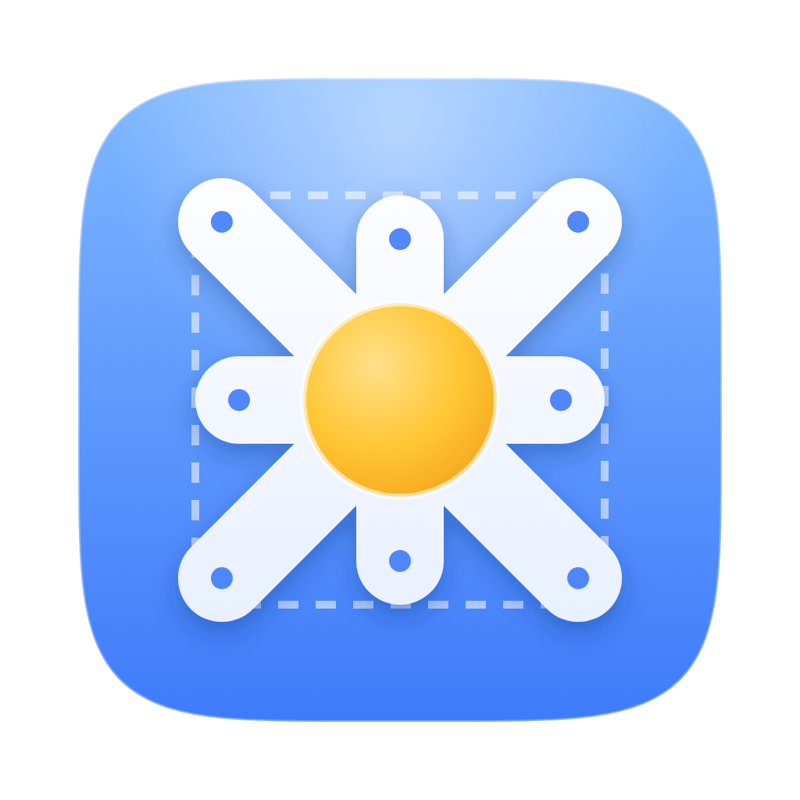
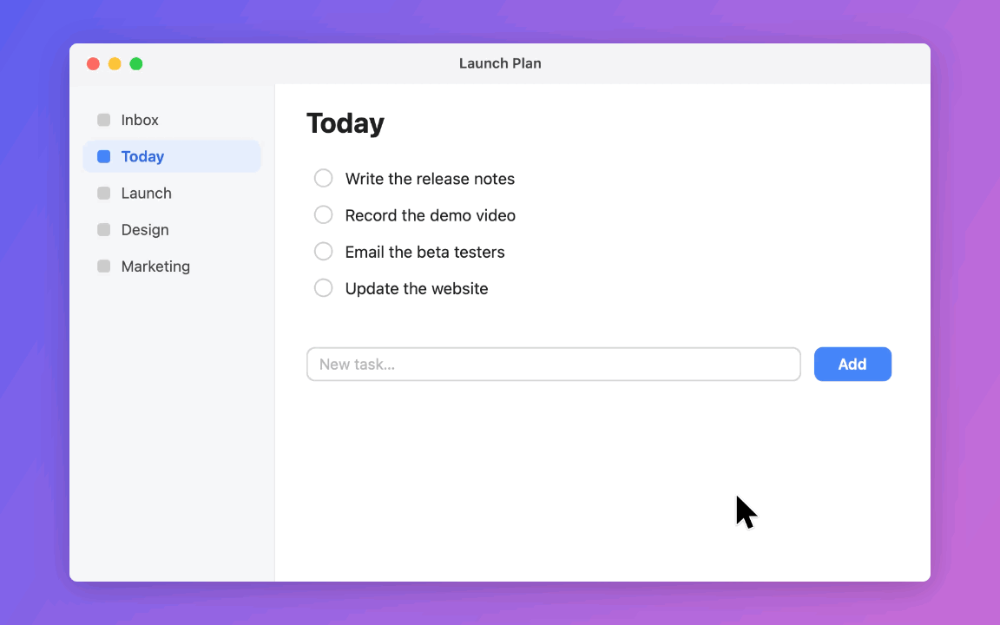
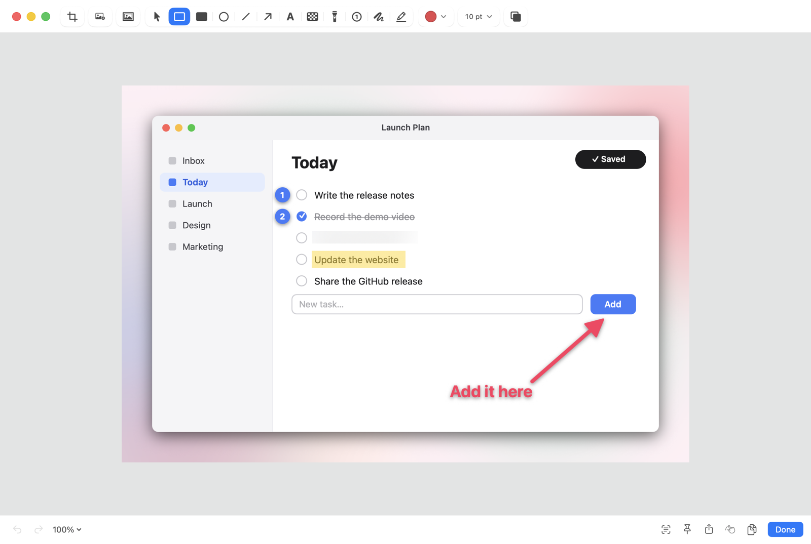
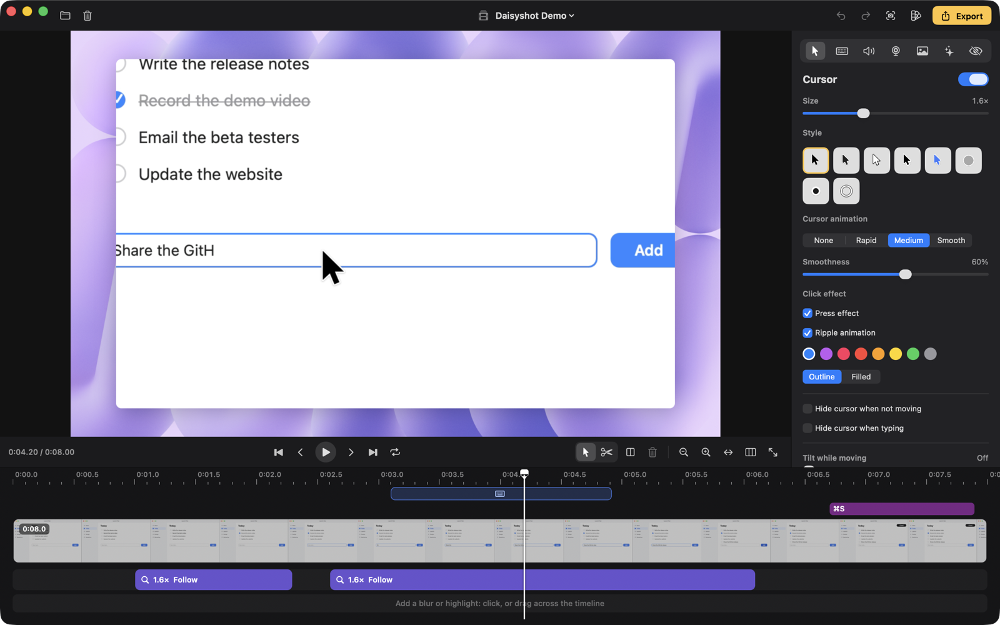
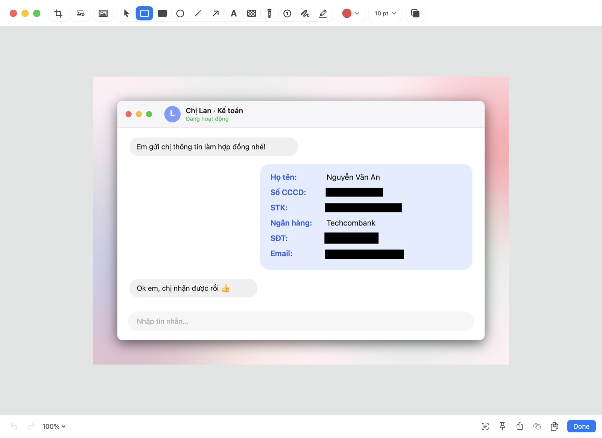

<div align="center">
  
  <br />
  <picture>
    <source media="(prefers-color-scheme: dark)" srcset="Assets/Logo/logotype-white.svg" />
    
  </picture>

  <p><strong>Chụp màn hình, quay màn hình và làm video màn hình đẹp mắt cho macOS — ngay trên thanh menu, chạy offline.</strong></p>

  <p><a href="https://daisyshot.app"><strong>daisyshot.app</strong></a></p>

  <p>
    Viết bằng <a href="https://developer.apple.com/xcode/swiftui/">SwiftUI</a>,
    <a href="https://developer.apple.com/documentation/appkit">AppKit</a>,
    <a href="https://developer.apple.com/documentation/screencapturekit">ScreenCaptureKit</a>,
    <a href="https://developer.apple.com/documentation/avfoundation">AVFoundation</a> và
    <a href="https://developer.apple.com/documentation/vision">Vision</a> — không dùng thư viện bên thứ ba.
  </p>

  <p>
    <a href="README.md">🇺🇸 English</a> •
    <a href="README.vi.md">🇻🇳 Tiếng Việt</a> •
    <a href="README.ko.md">🇰🇷 한국어</a> •
    <a href="README.ja.md">🇯🇵 日本語</a> •
    <a href="README.zh-Hans.md">🇨🇳 简体中文</a>
  </p>

  <p>
    <a href="https://github.com/tamhd148/daisyshot/releases/latest"></a>
    <a href="https://github.com/tamhd148/daisyshot/releases"></a>
    <a href="https://github.com/tamhd148/daisyshot/actions/workflows/build.yml"></a>
    
    <a href="LICENSE"></a>
    <a href="https://ko-fi.com/tamhd"></a>
  </p>

  <p>
    <a href="#cài-đặt">Cài đặt</a> •
    <a href="#bắt-đầu-nhanh">Bắt đầu nhanh</a> •
    <a href="#tính-năng">Tính năng</a> •
    <a href="#tự-che-thông-tin-nhạy-cảm">Tự che thông tin</a> •
    <a href="#phím-tắt">Phím tắt</a> •
    <a href="#tự-động-hoá-url-scheme">Tự động hoá</a> •
    <a href="#bảo-mật-và-quyền-riêng-tư">Bảo mật và quyền riêng tư</a> •
    <a href="#gỡ-cài-đặt">Gỡ cài đặt</a> •
    <a href="#build-từ-mã-nguồn">Build từ mã nguồn</a> •
    <a href="#đóng-góp">Đóng góp</a> •
    <a href="#giấy-phép-và-tên-gọi">Giấy phép</a>
  </p>
</div>



<p align="center"><sub>Xuất thẳng từ trình biên tập Studio — nền, zoom, con trỏ và phím bấm đều được thêm sau khi quay.</sub></p>

Daisyshot miễn phí và mã nguồn mở theo [giấy phép MIT](LICENSE). Nếu app giúp bạn tiết kiệm thời gian, bạn có thể
ủng hộ qua [Ko-fi](https://ko-fi.com/tamhd).

## Cài đặt

1. Tải `Daisyshot-<phiên bản>.dmg` từ [bản phát hành mới nhất](https://github.com/tamhd148/daisyshot/releases/latest) và
   kéo Daisyshot vào thư mục Applications.
2. Bản build chưa được Apple công chứng (notarize), nên macOS chặn lần mở đầu tiên. Bấm **Xong** (Done), rồi mở
   **Cài đặt hệ thống › Quyền riêng tư & Bảo mật**, bấm **Vẫn mở** (Open Anyway) cạnh dòng Daisyshot và xác nhận.
   (Hoặc dùng Terminal: `xattr -dr com.apple.quarantine /Applications/Daisyshot.app`.)
3. Cho phép quyền Ghi màn hình (Screen & System Audio Recording) khi được hỏi, rồi mở lại Daisyshot. App nằm trên thanh menu.

Các bản sau được cài ngay trong app (**Kiểm tra bản cập nhật…** trong menu trên thanh menu, hoặc tự động mỗi ngày một lần).
Bản cập nhật có chữ ký số, và Daisyshot chỉ cài gói mang chữ ký phát hành của mình.

Cần macOS 15 Sequoia trở lên, chip Apple hoặc Intel.

## Bắt đầu nhanh

1. Bấm **⌥⇧⌘4** rồi kéo chọn một vùng màn hình (hoặc **⌥⇧⌘5** để mở thanh chụp tất cả trong một).
2. Ảnh hiện trong một thẻ Quick Access: rê chuột lên thẻ và bấm **⌘C** để sao chép, **⌘S** để lưu, **⌘E** để chú thích
   hoặc **⌘P** để ghim lên màn hình — hoặc kéo thẳng thẻ sang app khác.
3. Bấm **⌥⇧⌘6** để quay: chọn một màn hình, một cửa sổ, một vùng hoặc iPhone / iPad đang cắm cáp, rồi bấm **Bắt đầu quay**.
   Dừng quay từ thanh menu; bản quay mở trong trình biên tập Studio, sẵn sàng để xuất.

## Tính năng

**Chụp màn hình**
- Chụp vùng, cửa sổ, toàn màn hình, vùng trước đó, hẹn giờ và chụp cuộn
- Chú thích (Annotate): mũi tên, hình khối, chữ, bút vẽ và bút dạ quang, làm mờ và pixel hoá, spotlight, đánh số bước,
  cắt ảnh, nền và khoảng đệm
- [Tự che thông tin nhạy cảm](#tự-che-thông-tin-nhạy-cảm): tìm API key, mật khẩu, email, số điện thoại, số thẻ,
  **số CCCD/CMND**, **số tài khoản ngân hàng** và **khuôn mặt** trong ảnh rồi chỉ che đúng những chỗ đó
- Sao chép chữ (OCR) và mã QR từ bất cứ thứ gì trên màn hình
- Ghim ảnh nổi trên các cửa sổ khác; thẻ Quick Access; lịch sử chụp có tìm kiếm



**Quay màn hình**
- Quay một màn hình, một cửa sổ, một vùng hoặc iPhone / iPad cắm cáp (USB)
- Bong bóng camera, micro và âm thanh hệ thống (theo từng app), hiển thị phím bấm và cú click, ghi chú khi quay (teleprompter)
- Xuất GIF, MP4, khôi phục bản quay bị gián đoạn

**Trình biên tập Studio** (cho các bản quay "Studio")
- Con trỏ mượt (kiểu, cỡ, motion blur, hiệu ứng và âm thanh click), zoom tự động bám theo con trỏ
- Nhận dạng đoạn gõ phím và tăng tốc bằng một cú bấm; cắt, tỉa, tách và tăng tốc clip
- Nền (wallpaper macOS, gradient, ảnh), khoảng đệm, bo góc, đổ bóng, mọi tỉ lệ khung hình
- Bố cục camera (chỉ camera, chỉ màn hình, vị trí tuỳ chỉnh), mask làm mờ và làm nổi bật có thể tự tìm chữ nhạy cảm
- Nhạc nền, lọc ồn, cân bằng âm lượng
- "Lấp đầy khung và bám theo con trỏ" cho video dọc hoặc vuông, xuất nhiều khổ cùng lúc
- Preset, Xuất nhanh ngay sau khi quay, phím tắt cho mọi thao tác



Ngôn ngữ giao diện: English, Tiếng Việt, 한국어, 日本語, 简体中文.

## Tự che thông tin nhạy cảm

Daisyshot đọc chữ trong ảnh chụp (và trong bản quay, cho mask của trình biên tập Studio) rồi che những gì không nên lộ —
chỉ che phần giá trị, nhãn bên cạnh vẫn đọc được. Mọi thứ chạy ngay trên máy bằng Vision của Apple, không gửi ảnh đi đâu.



<p align="center"><sub>Do Daisyshot tự tìm và tự che, không che bằng tay. Mọi thông tin trong ảnh đều là giả.</sub></p>

**Dành riêng cho người Việt:** app nhận ra **số CCCD/CMND**, **số tài khoản ngân hàng** cạnh chữ "STK", **số di động
Việt Nam** và **mật khẩu** cạnh chữ "mật khẩu" — tiện khi chụp màn hình app ngân hàng, giấy tờ, bảng tính khách hàng
hay tin nhắn chuyển khoản trước khi gửi đi.

| Nhận ra | Cách nhận |
|---|---|
| API key và secret | Định dạng key phổ biến (dịch vụ cloud, AI, GitHub, Slack, JWT, khoá riêng…) và chuỗi ngẫu nhiên dài sau `key`, `token`, `secret`… |
| Mật khẩu | Giá trị sau `password`, `pwd`, `mật khẩu`… |
| Email, token trong URL, địa chỉ IP | Địa chỉ email; giá trị `token=`, `key=`, `session=`… trong đường link; IPv4 và IPv6 (mặc định tắt) |
| Số điện thoại | Số di động Việt Nam (`+84` / `0` với đầu 3, 5, 7, 8, 9) và số quốc tế |
| Số thẻ | 13–19 chữ số hợp lệ theo thuật toán Luhn, có đầu số như thẻ thật |
| **Số CCCD / CMND** | Dãy 12 hoặc 9 chữ số đứng cạnh `CCCD`, `CMND`, `căn cước`, `chứng minh` |
| **Số tài khoản ngân hàng** | Dãy số cạnh `STK`, `số tài khoản`, `số TK`, `account no.`; số IBAN |
| Khuôn mặt | Nhận diện khuôn mặt bằng Vision của Apple (mặc định tắt) |
| Mẫu của riêng bạn | Từ khoá hoặc biểu thức chính quy — tên mã dự án, mã khách hàng… |

Dùng trong Annotate (`⇧⌘R`), tự động sau mỗi lần chụp, hoặc bằng **Tìm thông tin nhạy cảm** trong trình biên tập Studio — tính năng này thêm mask làm mờ vào bản quay và cảnh báo khi nội dung dưới mask di chuyển.
Daisyshot cũng có thể nhắc bạn trước khi sao chép, kéo hay chia sẻ một ảnh còn lộ secret, mật khẩu hoặc số thẻ.
Chọn loại thông tin cần tìm, kiểu che và mẫu riêng trong **Cài đặt › Ảnh chụp màn hình**.

## Phím tắt

Phím tắt toàn cục mặc định (đổi hoặc thêm trong **Cài đặt › Phím tắt**; tạm dừng / tiếp tục, quay lại từ đầu, đánh dấu,
ghi chú khi quay… có sẵn ở đó nhưng chưa gán phím):

| Thao tác | Phím tắt |
|---|---|
| Thanh chụp tất cả trong một | `⌥⇧⌘5` |
| Chụp vùng | `⌥⇧⌘4` |
| Chụp toàn màn hình | `⌥⇧⌘3` |
| Chụp cửa sổ | `⌥⇧⌘W` |
| Chụp lại vùng trước đó | `⌥⇧⌘7` |
| Chụp cuộn | `⌥⇧⌘8` |
| Sao chép chữ (OCR) | `⌥⇧⌘2` |
| Quay màn hình / dừng quay | `⌥⇧⌘6` |
| Ẩn / hiện icon desktop | `⌥⇧⌘D` |
| Khôi phục thẻ vừa đóng | `⌥⇧⌘Z` |

**Thẻ Quick Access** — rê chuột lên thẻ rồi bấm:

| Thao tác | Phím |
|---|---|
| Sao chép | `⌘C` |
| Lưu (giữ `⌥` để dùng cách lưu còn lại) | `⌘S` |
| Chú thích / chỉnh sửa | `⌘E` |
| Ghim lên màn hình | `⌘P` |
| Xem nhanh (Quick Look) | `Space` |
| Chuyển vào Thùng rác | `⌘⌫` |
| Đóng | `⌘W` hoặc `Esc` |

Trình biên tập Studio có bộ phím tắt riêng (đổi được hết): bấm `⌘/` trong trình biên tập để xem.

## Tự động hoá (URL scheme)

Launcher, script và app Phím tắt (Shortcuts) có thể điều khiển Daisyshot qua các URL `daisyshot://`, ví dụ
`open "daisyshot://capture-area?action=copy"`. Lần đầu một app khác gửi lệnh, Daisyshot sẽ hỏi bạn trước khi chạy;
tắt API này trong **Cài đặt › Nâng cao**.

| Lệnh | Tác dụng |
|---|---|
| `capture-area` | Chụp một vùng (`x`, `y`, `width`, `height` tính bằng point và `display` để chụp luôn không cần chọn) |
| `capture-previous-area` | Chụp lại vùng trước đó |
| `capture-fullscreen` | Chụp cả một màn hình (`display`: 1, 2…) |
| `capture-window` | Chụp một cửa sổ |
| `all-in-one` | Mở thanh chụp tất cả trong một |
| `self-timer` | Chụp sau khi đếm ngược |
| `scrolling-capture` | Chụp cuộn (`start`, `autoscroll`: true / false) |
| `capture-text` | Sao chép chữ (OCR) từ màn hình hoặc từ `filepath`; `linebreaks`: true / false |
| `record-screen` | Bắt đầu quay, hoặc dừng bản quay đang chạy |
| `stop-recording` | Dừng bản quay đang chạy |
| `pin` | Ghim `filepath` (hoặc chọn một ảnh) lên màn hình |
| `open-annotate` | Chú thích `filepath` (hoặc chọn một file) |
| `open-from-clipboard` | Chú thích ảnh trong clipboard |
| `add-quick-access-overlay` | Hiện `filepath` trong một thẻ Quick Access |
| `open-history` | Mở lịch sử chụp |
| `restore-recently-closed` | Khôi phục thẻ Quick Access vừa đóng |
| `close-all-overlays` | Đóng mọi thẻ Quick Access |
| `toggle-desktop-icons`, `hide-desktop-icons`, `show-desktop-icons` | Icon desktop |
| `open-settings` | Mở Cài đặt (`tab`: general, shortcuts, quickAccess, wallpaper, screenshots, screenRecording, annotate, advanced, about) |

Các lệnh chụp còn nhận `action` = `copy`, `save`, `annotate` hoặc `pin` để thay cho cài đặt Sau khi chụp.

## Bảo mật và quyền riêng tư

Daisyshot chạy offline: không tài khoản, không thu thập dữ liệu, không lưu trên mây. Ảnh chụp và bản quay nằm trên máy Mac
của bạn, trong thư mục bạn chọn và trong `~/Library/Application Support/Daisyshot`.

- **Mạng:** kết nối duy nhất là kiểm tra cập nhật — mỗi ngày một lần app hỏi GitHub bản phát hành mới nhất (tắt trong
  **Cài đặt › Chung**); không gửi gì về bạn hay file của bạn. Bản cập nhật chỉ được tải khi bạn chọn cài, và chỉ được cài
  khi mang chữ ký Ed25519 của Daisyshot, đúng app và đúng phiên bản.
- **Mã:** app chạy với Hardened Runtime của macOS và không chạy trong sandbox (chụp màn hình, phím tắt toàn cục và ghi
  phím bấm cần vậy). Bản phát hành được ký ad-hoc, chưa được Apple công chứng.
- **Tự động hoá:** lệnh `daisyshot://` từ app khác cần bạn đồng ý lần đầu và có thể tắt.

App xin các quyền macOS sau, mỗi quyền chỉ dùng cho tính năng cần đến nó:

| Quyền | Dùng cho |
|---|---|
| Ghi màn hình và âm thanh hệ thống | Chụp và quay màn hình |
| Trợ năng (Accessibility) | Phím bấm trong video, nhận dạng đoạn gõ phím, ẩn con trỏ khi gõ, đưa cửa sổ lên trước |
| Camera / Micro | Bong bóng camera và giọng nói trong bản quay |

Phát hiện lỗi bảo mật? Hãy báo riêng — xem [SECURITY.md](SECURITY.md).

## Gỡ cài đặt

Thoát Daisyshot, rồi chạy:

```bash
rm -rf /Applications/Daisyshot.app
```

Để xoá luôn cài đặt và các quyền đã cấp:

```bash
defaults delete app.daisyshot.mac; tccutil reset All app.daisyshot.mac
```

`~/Library/Application Support/Daisyshot` chứa lịch sử chụp, bản quay và preset — chỉ xoá khi bạn không cần chúng nữa.
Muốn đặt lại quyền mà không gỡ app, chỉ cần chạy `tccutil reset All app.daisyshot.mac`.

## Build từ mã nguồn

Cần Xcode 26 (Swift 6, SDK macOS 26). Không dùng thư viện bên thứ ba.

```bash
swift build                      # bản debug
./scripts/build-app.sh           # app đã ký trong build/Daisyshot.app (ký ad-hoc nếu không đặt SIGN_ID)
./scripts/make-dmg.sh            # file .dmg để phân phối
```

Phát hành: chạy `swift scripts/update-key.swift generate` một lần (tạo khoá ký ngoài repo và in khoá công khai để đặt vào
`Updater.publicKey`), sau đó tăng `VERSION`, viết ghi chú phát hành rồi chạy `./scripts/release.sh notes.md` — script build
file .dmg, gói cập nhật đã ký và đăng bản phát hành lên GitHub.

Bộ kiểm tra có sẵn chạy bằng `DAISYSHOT_SELFTEST=1 .build/debug/Daisyshot` (in PASS / FAIL cho từng phần rồi thoát).
Bản dịch được kiểm tra bằng `python3 scripts/loc-check.py`.

Cấu trúc mã (`Sources/Daisyshot`):

| Thư mục | Nội dung |
|---|---|
| `App` | App delegate, phím tắt toàn cục, cài đặt, URL scheme API, quyền, cập nhật |
| `Capture` | Chụp màn hình, lớp chọn vùng, chụp cuộn, OCR |
| `Annotate` | Trình chú thích, nền, Tự che |
| `Recording` | Bộ quay, chuẩn bị quay, trình biên tập Studio (mô hình, dựng hình, timeline, xuất) |
| `UI` | Quick Access, ghim, lịch sử, giao diện dùng chung |
| `Settings` | Cửa sổ và các trang cài đặt |

## Đóng góp

Báo lỗi, sửa lỗi và bản dịch đều được chào đón — xem [CONTRIBUTING.md](CONTRIBUTING.md) (tiếng Anh).

## Giấy phép và tên gọi

Mã nguồn theo [giấy phép MIT](LICENSE), © 2026 Tam Hoang.

Tên **Daisyshot**, logo và biểu tượng app không nằm trong giấy phép MIT. Bạn được tự do fork và phát hành lại mã nguồn,
nhưng hãy đặt tên và biểu tượng khác cho phiên bản của bạn để mọi người không nhầm với app chính thức.
