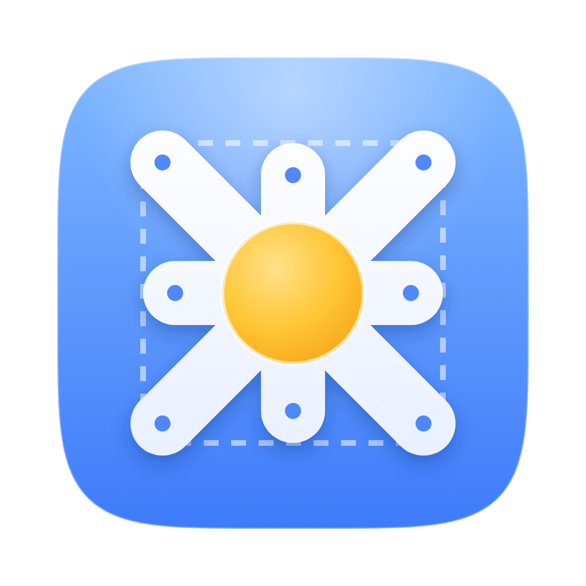
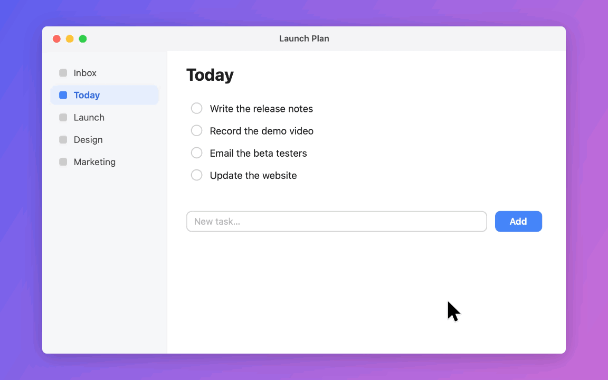
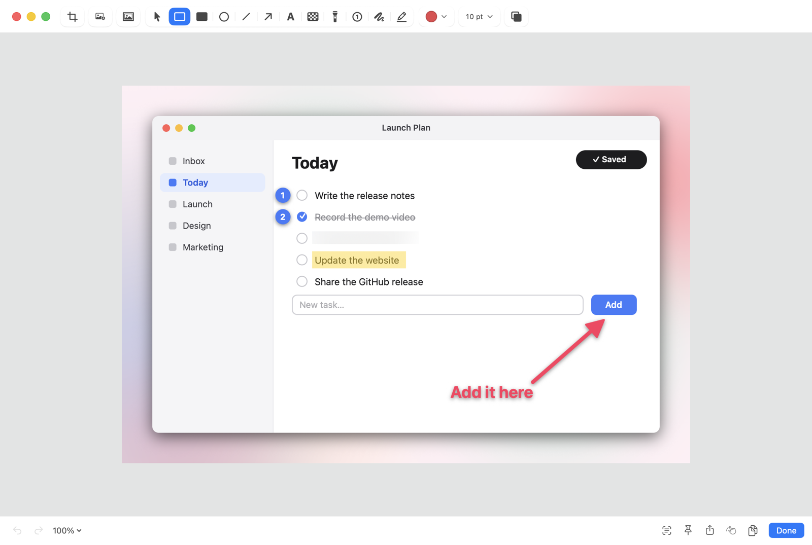
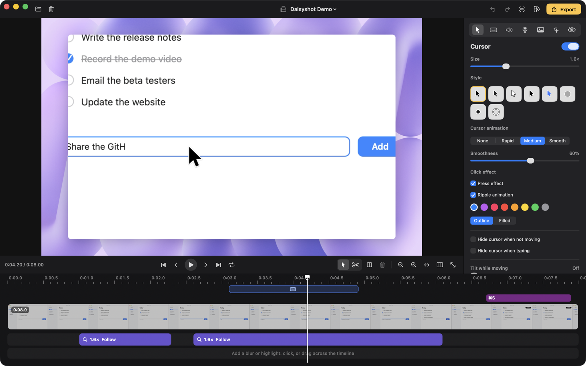
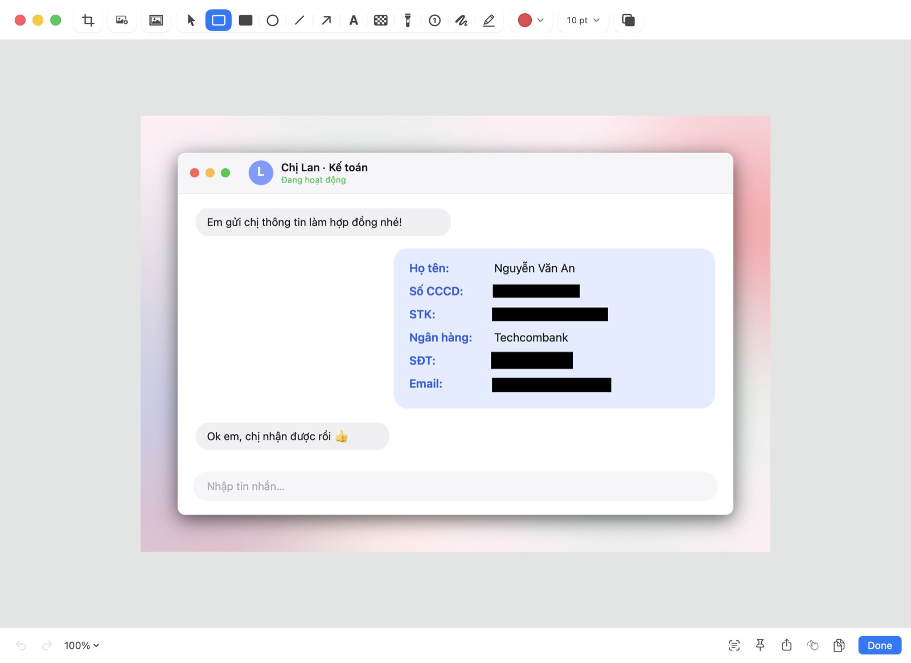

<div align="center">
  
  <br />
  <picture>
    <source media="(prefers-color-scheme: dark)" srcset="Assets/Logo/logotype-white.svg" />
    
  </picture>

  <p><strong>适用于 macOS 的截屏、屏幕录制和精致屏幕视频——在菜单栏中完成，无需联网。</strong></p>

  <p><a href="https://daisyshot.app"><strong>daisyshot.app</strong></a></p>

  <p>
    使用 <a href="https://developer.apple.com/xcode/swiftui/">SwiftUI</a>、
    <a href="https://developer.apple.com/documentation/appkit">AppKit</a>、
    <a href="https://developer.apple.com/documentation/screencapturekit">ScreenCaptureKit</a>、
    <a href="https://developer.apple.com/documentation/avfoundation">AVFoundation</a> 和
    <a href="https://developer.apple.com/documentation/vision">Vision</a> 构建——没有任何第三方依赖。
  </p>

  <p>
    <a href="README.md">🇺🇸 English</a> •
    <a href="README.vi.md">🇻🇳 Tiếng Việt</a> •
    <a href="README.ko.md">🇰🇷 한국어</a> •
    <a href="README.ja.md">🇯🇵 日本語</a> •
    <a href="README.zh-Hans.md">🇨🇳 简体中文</a>
  </p>

  <p>
    <a href="https://github.com/tamhd148/daisyshot/releases/latest"></a>
    <a href="https://github.com/tamhd148/daisyshot/releases"></a>
    <a href="https://github.com/tamhd148/daisyshot/actions/workflows/build.yml"></a>
    
    <a href="LICENSE"></a>
    <a href="https://ko-fi.com/tamhd"></a>
  </p>

  <p>
    <a href="#安装">安装</a> •
    <a href="#快速上手">快速上手</a> •
    <a href="#功能">功能</a> •
    <a href="#自动遮盖">自动遮盖</a> •
    <a href="#快捷键">快捷键</a> •
    <a href="#自动化与-url-协议">自动化</a> •
    <a href="#安全与隐私">安全与隐私</a> •
    <a href="#卸载">卸载</a> •
    <a href="#从源代码构建">从源代码构建</a> •
    <a href="#参与贡献">参与贡献</a> •
    <a href="#许可证与名称">许可证</a>
  </p>
</div>



<p align="center"><sub>直接从 Studio 编辑器导出——背景、缩放效果、指针和按键都是在录制后添加的。</sub></p>

Daisyshot 是免费的开源软件，采用 [MIT 许可证](LICENSE)。如果它为你节省了时间，欢迎在 [Ko-fi](https://ko-fi.com/tamhd)
上支持它的开发。

## 安装

1. 从[最新版本](https://github.com/tamhd148/daisyshot/releases/latest)下载 `Daisyshot-<version>.dmg`，然后将
   Daisyshot 拖到“应用程序”文件夹。
2. 目前的版本尚未经过 Apple 公证，因此 macOS 会阻止首次打开。点按**完成**，然后打开
   **系统设置 › 隐私与安全性**，点按 Daisyshot 旁边的**仍要打开**并确认。
   （或在终端中运行：`xattr -dr com.apple.quarantine /Applications/Daisyshot.app`。）
3. 出现提示时允许“录屏与系统录音”，然后重新打开 Daisyshot。它位于菜单栏中。

之后的版本可在 App 内安装（菜单栏菜单中的**检查更新…**，或每天自动检查一次）。
更新均经过签名，Daisyshot 只会安装带有其发布签名的归档。

需要 macOS 15 Sequoia 或更高版本，支持 Apple 芯片和 Intel 芯片。

## 快速上手

1. 按下 **⌥⇧⌘4** 并在屏幕上拖移选择一块区域（或按 **⌥⇧⌘5** 打开多合一捕捉栏）。
2. 截屏会出现在快速访问浮窗中：将指针悬停在上面，按 **⌘C** 拷贝、**⌘S** 存储、**⌘E** 标注，或按
   **⌘P** 将其固定到屏幕——也可以直接将它拖到其他 App 中。
3. 按下 **⌥⇧⌘6** 开始录制：选择显示器、窗口、区域或已连接的 iPhone / iPad，然后点按**开始录制**。
   从菜单栏停止录制；录屏会在 Studio 编辑器中打开，随时可以导出。

## 功能

**截屏**
- 区域、窗口、全屏、上次区域、定时截屏和滚动截屏
- 标注：箭头、形状、文本、钢笔和荧光笔、模糊和像素化、聚光灯、编号步骤、裁剪、
  背景和边距
- [自动遮盖](#自动遮盖)：找出图像中的 API 密钥、密码、电子邮件、电话号码、卡号和证件号码、银行账号以及
  人脸，并只遮盖这些内容
- 从屏幕上的任何内容中拷贝文本（OCR）和二维码
- 将截屏固定在其他窗口之上；快速访问浮窗；可搜索的捕捉历史



**录制**
- 录制显示器、窗口、区域或已连接的 iPhone / iPad（USB）
- 摄像头气泡、麦克风和系统音频（可按 App 选择）、按键和点按突出显示、演讲者备注 / 提词器
- 导出 GIF、导出 MP4，中断的录制可在崩溃后恢复

**Studio 编辑器**（用于“Studio”录屏）
- 平滑指针（样式、大小、动态模糊、点按效果和音效），跟随指针的自动缩放效果
- 打字检测，一键加速；剪切、修剪、拆分和加速片段
- 背景（macOS 墙纸、渐变、图像）、边距、圆角、阴影，任意宽高比
- 摄像头布局（仅摄像头、仅屏幕、自定位置），可找出敏感文字的模糊和突出显示遮罩
- 背景音乐、降噪、统一响度
- 用于竖屏或方形视频的“填满画面并跟随指针”，一次导出多种格式
- 预设、录制后立即快速导出，所有操作都有键盘快捷键



界面语言：English、Tiếng Việt、한국어、日本語、简体中文。

## 自动遮盖

Daisyshot 会读取截屏中的文字（以及录屏中的文字，用于 Studio 编辑器的遮罩），遮盖不应分享的内容——只遮盖值本身，旁边的标签仍清晰可读。
所有处理都通过 Apple 的 Vision 在你的 Mac 上完成。



<p align="center"><sub>由自动遮盖找出并遮盖，而非手动完成。图中所有信息均为虚构。</sub></p>

| 查找内容 | 方式 |
|---|---|
| API 密钥与机密 | 已知的密钥格式（云服务商、AI 服务、GitHub、Slack、JWT、私钥等），以及 `key`、`token`、`secret` 等词后面的长随机值 |
| 密码 | `password`、`pwd`、`mật khẩu` 等词后面的值 |
| 电子邮件、URL 中的令牌、IP 地址 | 邮件地址；链接中 `token=`、`key=`、`session=` 等参数的值；IPv4 和 IPv6（默认关闭） |
| 电话号码 | 越南手机号码（`+84` / `0` 开头，后接 3、5、7、8、9）及国际号码 |
| 卡号 | 通过 Luhn 校验且开头符合真实卡号的13–19位数字 |
| **证件号码（CCCD / CMND）** | `CCCD`、`CMND`、`căn cước`、`chứng minh` 旁边的12位或9位数字 |
| **银行账号** | `STK`、`số tài khoản`、`số TK`、`account no.` 旁边的数字；IBAN |
| 人脸 | Apple Vision 人脸检测（默认关闭） |
| 你自己的规则 | 关键词或正则表达式——项目代号、客户 ID 等 |

可以在标注中运行（`⇧⌘R`），也可以在每次捕捉后自动运行，或在 Studio 编辑器中使用**查找敏感信息**——它会为录屏添加模糊遮罩，并在遮罩下的内容移动时发出提醒。在你拷贝、拖移或分享仍显示机密、密码或卡号的截屏之前，
Daisyshot 也可以发出提醒。在**设置 › 截屏**中选择要查找的内容、遮盖样式以及你自己的规则。

## 快捷键

开箱即用的全局快捷键（可在**设置 › 快捷键**中更改或添加更多；暂停 / 继续、重新开始、标记、
演讲者备注等也在那里，但没有默认快捷键）：

| 操作 | 快捷键 |
|---|---|
| 多合一捕捉栏 | `⌥⇧⌘5` |
| 捕捉区域 | `⌥⇧⌘4` |
| 捕捉全屏 | `⌥⇧⌘3` |
| 捕捉窗口 | `⌥⇧⌘W` |
| 捕捉上次区域 | `⌥⇧⌘7` |
| 滚动截屏 | `⌥⇧⌘8` |
| 识别文本（OCR） | `⌥⇧⌘2` |
| 录制屏幕 / 停止录制 | `⌥⇧⌘6` |
| 隐藏 / 显示桌面图标 | `⌥⇧⌘D` |
| 恢复最近关闭的项目 | `⌥⇧⌘Z` |

**快速访问浮窗**——将指针悬停在浮窗上，然后按：

| 操作 | 按键 |
|---|---|
| 拷贝 | `⌘C` |
| 存储（按住 `⌥` 使用另一种存储方式） | `⌘S` |
| 标注 / 编辑 | `⌘E` |
| 固定到屏幕 | `⌘P` |
| 快速查看 | `Space` |
| 移到废纸篓 | `⌘⌫` |
| 关闭 | `⌘W` 或 `Esc` |

Studio 编辑器有自己的快捷键（均可重新指定）：在编辑器中按 `⌘/` 即可查看。

## 自动化与 URL 协议

启动器、脚本和“快捷指令” App 可以通过 `daisyshot://` URL 控制 Daisyshot，例如
`open "daisyshot://capture-area?action=copy"`。其他 App 首次发送命令时，Daisyshot 会先询问你再执行；
可在**设置 › 高级**中关闭此 API。

| 命令 | 作用 |
|---|---|
| `capture-area` | 捕捉区域（传入 `x`、`y`、`width`、`height`（单位为点）和 `display` 可跳过选择直接捕捉） |
| `capture-previous-area` | 再次捕捉上一次的区域 |
| `capture-fullscreen` | 捕捉整个显示器（`display`：1、2…） |
| `capture-window` | 捕捉窗口 |
| `all-in-one` | 打开多合一捕捉栏 |
| `self-timer` | 倒计时结束后捕捉 |
| `scrolling-capture` | 滚动截屏（`start`、`autoscroll`：true / false） |
| `capture-text` | 从屏幕或 `filepath` 拷贝文本（OCR）；`linebreaks`：true / false |
| `record-screen` | 开始录制，或停止正在进行的录制 |
| `stop-recording` | 停止正在进行的录制 |
| `pin` | 将 `filepath`（或选取一张图像）固定到屏幕 |
| `open-annotate` | 标注 `filepath`（或选取一个文件） |
| `open-from-clipboard` | 标注剪贴板中的图像 |
| `add-quick-access-overlay` | 在快速访问浮窗中显示 `filepath` |
| `open-history` | 打开捕捉历史 |
| `restore-recently-closed` | 恢复最近关闭的快速访问浮窗 |
| `close-all-overlays` | 关闭所有快速访问浮窗 |
| `toggle-desktop-icons`、`hide-desktop-icons`、`show-desktop-icons` | 桌面图标 |
| `open-settings` | 打开设置（`tab`：general, shortcuts, quickAccess, wallpaper, screenshots, screenRecording, annotate, advanced, about） |

捕捉命令还接受 `action` = `copy`、`save`、`annotate` 或 `pin`，以覆盖“捕捉后”设置。

## 安全与隐私

Daisyshot 离线工作：无需账户，没有分析统计，不使用云端。截屏和录屏都保留在你的 Mac 上，存放在你选择的文件夹
以及 `~/Library/Application Support/Daisyshot` 中。

- **网络：**它唯一的网络请求是检查更新——每天向 GitHub 查询一次最新版本（可在
  **设置 › 通用**中关闭）；不会发送任何关于你或你的文件的信息。只有在你安装更新时才会下载更新，而且
  只有带有 Daisyshot 的 Ed25519 发布签名、且是预期的 App 和版本时才会安装。
- **代码：**App 在 macOS 强化运行时（Hardened Runtime）下运行，未启用沙盒（屏幕捕捉、全局快捷键和
  按键记录需要如此）。发布版本采用临时（ad-hoc）签名，尚未经过 Apple 公证。
- **自动化：**其他 App 发来的 `daisyshot://` 命令首次需要你的同意，并且可以关闭。

它会请求以下 macOS 权限，每项权限仅用于需要它的功能：

| 权限 | 用途 |
|---|---|
| 录屏与系统录音 | 截屏和录制屏幕 |
| 辅助功能 | 录屏中的按键、打字检测、键入时隐藏指针、将窗口置于前台 |
| 摄像头 / 麦克风 | 摄像头气泡和录屏中的人声 |

发现了安全问题？请私下报告——参见 [SECURITY.md](SECURITY.md)。

## 卸载

退出 Daisyshot，然后运行：

```bash
rm -rf /Applications/Daisyshot.app
```

如需同时移除其设置和权限：

```bash
defaults delete app.daisyshot.mac; tccutil reset All app.daisyshot.mac
```

`~/Library/Application Support/Daisyshot` 中保存着你的捕捉历史、录屏和预设——只有在不再需要它们时才删除。
如需在不卸载的情况下重置权限，只运行 `tccutil reset All app.daisyshot.mac` 即可。

## 从源代码构建

要求：Xcode 26（Swift 6、macOS 26 SDK）。没有任何第三方依赖。

```bash
swift build                      # debug build
./scripts/build-app.sh           # signed app bundle in build/Daisyshot.app (ad-hoc unless SIGN_ID is set)
./scripts/make-dmg.sh            # disk image for distribution
```

发布：先运行一次 `swift scripts/update-key.swift generate`（在仓库之外创建签名密钥，并打印出
要填入 `Updater.publicKey` 的公钥），然后更新 `VERSION`、撰写发布说明并运行
`./scripts/release.sh notes.md`——它会构建磁盘映像和已签名的更新归档，并发布 GitHub 版本。

内置检查通过 `DAISYSHOT_SELFTEST=1 .build/debug/Daisyshot` 运行（它会按模块打印 PASS / FAIL，然后退出）。
翻译通过 `python3 scripts/loc-check.py` 检查。

代码结构（`Sources/Daisyshot`）：

| 文件夹 | 内容 |
|---|---|
| `App` | App 代理、全局快捷键、偏好设置、URL 协议 API、权限、更新 |
| `Capture` | 截屏捕捉、选择浮层、滚动截屏、OCR |
| `Annotate` | 标注编辑器、背景、自动遮盖 |
| `Recording` | 录制器、录制设置、Studio 编辑器（模型、渲染器、时间线、导出） |
| `UI` | 快速访问、固定图像、历史、共享 UI |
| `Settings` | 设置窗口和各个面板 |

## 参与贡献

欢迎提交错误报告、修复和翻译——参见 [CONTRIBUTING.md](CONTRIBUTING.md)。

## 许可证与名称

源代码采用 [MIT 许可证](LICENSE)授权，© 2026 Tam Hoang。

**Daisyshot** 这一名称以及 Daisyshot 标志和 App 图标不在 MIT 许可证的授权范围内。欢迎你复刻并重新分发
代码，但请为你的版本使用不同的名称和图标，以免他人误以为是官方 App。
